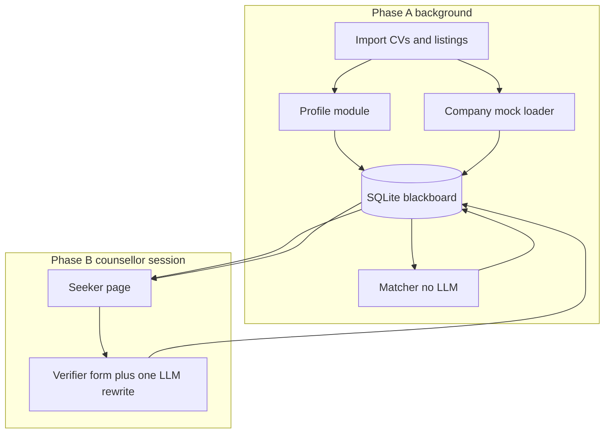

# Career counsellor multi-agent system

This plan is the refined architecture, requirements, backlog, and sprints. It is **not code**. After you confirm, the same content will be split into a docs folder with an index (see the last section).

Your architecture picture was not in the empty repo. The design below is based on your written draft plus the research passes.

**Locked choices from you:** background matching so a counsellor opens a seeker and sees a ready list; the Verifier may ask the counsellor short questions to shrink that list.

---

## 1. Refined architecture

### What we keep from your draft

Specialists still exist: **Profile**, **Matcher**, **Company**, **Verifier**. They share one store. The counsellor still gets a shortlist plus a **why** for each job. The system still runs in the background, then talks to the counsellor only when a case is opened.

### What we change (and why, in plain language)

- **Not a classic blackboard.** A classic blackboard is a control loop where specialists decide *who runs next*. Your path is already known: extract → match → maybe ask. Build a **shared SQLite database + a background job**. In the report, call that shared store the blackboard. In the code, it is tables. See [Hayes-Roth / Nii blackboard model](http://www.cs.cmu.edu/afs/cs/project/tinker-arch/www/html/1998/questions/20.Blackboard.html) vs a fixed workflow ([Anthropic: building effective agents](https://www.anthropic.com/engineering/building-effective-agents)).
- **Most “agents” are modules, not chatbots.** Only the Verifier talks to a human. Profile is one LLM extract. Matcher is **no LLM**. Company in v1 is **load mock JSON**. No CrewAI/AutoGen group chat ([CrewAI review](e0c1019b-45b9-4ada-bb94-4624b9251048)).
- **Score first, then explain.** Matcher writes numbers and feature hits. Night-time WHY is a **template** from those hits so the overnight job cannot invent skills. After counsellor questions, **one LLM rewrite** on leftover jobs only ([second review](78f4528a-b178-453d-be92-103d65de99bd), [JobMatchAI: score then narrate](https://arxiv.org/html/2603.14558)).
- **Company “scraper” is mocked.** RAGdoll’s scraper is PDF chunking, not a web crawler. Glassdoor/Indeed scraping is out. Ten mock Norwegian employers with **opposite** culture tags so questions actually change the list ([company data](b9a3d44f-4fd3-4c12-8bae-fe73d67f2cfb)).
- **RAGdoll is not the product.** Skip in v1. Do not ingest CVs or jobs into it. A hosted company-doc chat is P2 only, after Phase B already works ([RAGdoll fit](553e47ce-728d-4cde-a5f2-ab50acdcb062), [reconcile](13c51943-7582-47c6-8c98-7ed75ef721f0)).

### Two phases (this is the whole system)

**Phase A (no human):** load or extract profile → Matcher scores (ignore culture) → Verifier A hard-drops only known clashes and `do_not_recommend` companies, flags unknown prefs, writes template WHY. Counsellor never waits.

**Phase B (human):** counsellor opens seeker → sees ready list → one form of **at most 5** MCQs (stop if list already ≤3 or a flag would not split the list) → list shrinks on the same page → answers saved as `preference` rows → next night run reuses them. Skip does not become a stored fact.

### Modules (four people, four owners)

- **Profile** (LLM yes, but **not in Sprint 1**): PDF text → seeker row. Until Sprint 4, load mock seeker JSON. Synthetic CVs only. No OCR.
- **Matcher** (LLM no): hard filters then a tiny weighted score. Writes `match_result` + `feature_hits`. Ignores culture and caution. Does not write essays.
- **Company** (LLM no): load ~10 mock profiles. `shift_work` is a **fact**, not a sixth culture trait. Do not build a fetcher.
- **Verifier** (the only true agent): Phase A hard-drop + flags + template WHY. Phase B form + persist prefs + optional LLM rewrite of leftover WHY. No dedicated Explainer module.

**Orchestrator:** FastAPI + a worker that runs on startup and on Refresh. Not Temporal, not LangGraph.

**UI:** FastAPI + simple HTML templates (Jinja), one process. Three screens: seeker list, seeker page, import. Streamlit is the fallback only if templates eat Sprint 1. No seeker-facing app. No NAV integration.

### Data (six SQLite tables)

From [data model](8ac7334d-0d43-48d7-b06a-3d36973cb4e2). English keys, Norwegian labels in the UI. Join on `company_id` and `listing_id`. Skills = lowercase tokens (`python`). Languages = `nb` / `en`.

- **company:** `company_id`, `name`, `aliases`, `industry`, `size_band`, `locations`, `work_mode_default`, `shift_work`, five traits (`social_gatherings`, `team_collaboration`, `work_intensity`, `structure_formality`, `learning_support`) each `{level, confidence, evidence}`, `synthesis`, `caution_flags`, `source=mock`
- **listing:** `listing_id`, `company_id` (nullable until name resolve), `company_name`, `title`, `city`, `work_mode`, `seniority`, `skills`, `languages`, `education_min`, `description`, `status`
- **seeker:** profile fields + `matching_text` (for WHY, not scoring) + `extract_quality` + `pipeline_status`
- **preference:** `seeker_id` + key (`trait_key` or `work_mode` / `shift_work`) + `level` + `source=counsellor`. No chat log.
- **match_run:** `run_id`, `algo_version`, counts, timestamps
- **match_result:** pool of top ~10–20 per seeker (not every rejected pair). Rank, score, `feature_scores`, `feature_hits`, `filter_relaxed`, `status` kept/hidden, `dropped_reason` (Verifier only), `why_text` (empty until Verifier)

Matcher does not write 10k drop rows. Empty-after-filters is a note on `match_run`.

Mock corpus: **≥15 seekers, ≥40 listings, ≥10 companies** with opposite culture tags.

### Stack

Python 3.12, FastAPI, Jinja, SQLite (WAL), APScheduler or run-on-start + Refresh, PyMuPDF (Sprint 4), LiteLLM or OpenAI-compatible `base_url`. No vector DB, no Postgres, no Next.js, no Keycloak, no Streamlit unless Jinja slips.

### RAGdoll (IMTEL)

Do **not** fork [IMTEL/RAGdoll](https://github.com/IMTEL/RAGdoll). It is a RAG **chat** product (Mongo, FAISS, Keycloak, `/api/chat/ask`). No retrieve-only API. Do not put CVs on `iplvr.it.ntnu.no`. Not on the critical path. P2 only after Phase B works, and only for public company text.

---

## 2. Implementation plan

Build **one vertical path** first, then hang modules on the same tables.

1. Freeze schema + mock data + “decision support, synthetic data” banner.
2. Import listings + **mock seeker JSON** (not PDF) → Matcher writes top-k → counsellor sees a ready list.
3. Company JSON + Verifier Phase A (flags, template WHY, caution hard-drop).
4. Phase B questions that **visibly shrink** the list; persist prefs; grounding test.
5. Sprint 4: synthetic PDF → JSON extract, then rematch. If this slips, the demo still works from mock JSON.
6. Statuses, traces, demo script, report.

If time dies, cut in this order: RAGdoll helper → PDF extract → LLM WHY (keep template) → extra culture questions. **Do not cut** import, match list, or questions that shrink the list. PDF extract is the slip, not Verifier ([reconcile](13c51943-7582-47c6-8c98-7ed75ef721f0)).

---

## 2.1 Requirements (MoSCoW)

From [requirements](09259928-057b-477c-88a5-d1d70dd14296), tightened by [second review](78f4528a-b178-453d-be92-103d65de99bd).

**MUST — functional**

- **FR1** Counsellor-only: no seeker login, no apply, no seeker portal.
- **FR2** Import CSV/JSON listings and seeker records (JSON in v1; PDF CVs as Sprint 4 P1); a second import adds more.
- **FR3** Profile writes one seeker row (ids, headline, roles, skills, education_level, languages, city, work_mode, seniority, years, availability, matching_text, extract_quality). Counsellor answers live in `preference`, not inside the extract blob.
- **FR4** Mock `CompanyProfile` by `company_id`; many listings share one company.
- **FR5** Background match every usable seeker; store top-k (default 8, range 5–10) **before** the counsellor opens the case.
- **FR6** Opening a `matched` seeker shows the **stored** list: title, company, rank, score, why_text — no rematch on page load.
- **FR7** Matcher hard-filters then scores named features; `feature_hits` only values that exist on seeker and listing.
- **FR8** WHY must not name a skill/title/city/language absent from extracted fields. Phase A may be a template; Phase B may LLM-rewrite leftover jobs only.
- **FR9** Verifier shows **at most 5** MCQs in one form (skip allowed; stop if list ≤3 or a flag would not split); list shrinks/re-ranks on the same page.
- **FR10** Answers stored as `preferences` (not chat). Reload keeps the shrunk list. Next background run reuses them.
- **FR11** Seeker list shows one status in `{imported, profile_ready, matched, needs_questions, stale, error}`.
- **FR12–FR14** Listing / company / match-result field contracts as in section 1.

**SHOULD**

- **FR15** After answers, rewrite WHY only for remaining jobs; dropped jobs keep `dropped_reason`.
- **FR16** If filters yield zero, relax one filter, set `filter_relaxed=true`, still store top-k.
- **FR17** Re-import updates the row and marks related seekers `stale`.
- **FR18** Named empty and error states, never a blank screen.

**COULD**

- **FR19** Refresh one seeker.
- **FR20** Cosine of `matching_text` vs description as an extra feature, default off.

**MUST — quality**

- **NFR1** Demo corpus (≤50×200; ship ≥15×40) background pass ≤10 minutes on a laptop.
- **NFR2** After last answer, visible list updates ≤10 seconds.
- **NFR3** Fixture test fails if WHY invents a skill.
- **NFR4** ≥10 mock companies with distinct culture levels so **at least one answer changes the shortlist**.

**MUST — ethics**

- **ETH1** Synthetic CVs and mocks only; reject real personal CVs.
- **ETH2** No Glassdoor/Indeed/LinkedIn/Facebook fetch; `source=mock`.
- **ETH3** Banner: decision support, not auto-hire.
- **ETH4** No gender/age/ethnicity/disability/photo/name-origin in profiles or scoring.

**MUST NOT (out of scope)**

- Live crawl, review-site scrape, seeker app, auto-apply, NAV integration, CrewAI/AutoGen, LLM-as-judge of all pairs, RAGdoll as matcher or CV store, real PII in cloud without DPIA, production auth.

---

## 3. Backlog (9 Sep – 10 Nov 2026)

Capacity from [sprint planning](2d8fb4df-a77e-423f-a8d2-c1f9476ed3ae): **~26 effective coding person-days**, not 64. Uke 40 (28 Sep–4 Oct) is reduced. Meetings, customer, planning, retro, and docs live on the **meeting day**, not the two coding days.

**Ownership:** Profile | Matcher | Company+mocks | UI+Verifier. Shared: schema, LLM wrapper, decision log.

**P0 (must demo)** — from [sprint backlog](841e6e83-3534-4aa4-b1aa-6db62f90b1a9), packed so Verifier is not optional.

- Schema + SQLite + README on two laptops
- Mock listings, 10 companies, 15 synthetic seekers (JSON first; PDFs later)
- Import listings CSV/JSON + seeker JSON (PDF import in Sprint 4)
- Hybrid matcher + background top-k + feature_hits
- Seeker list + seeker page with template WHY
- Verifier ≤5 MCQs that shrink the list + persist prefs + drop reasons
- Grounding test + decision log + prototype banner
- Next batch uses stored preferences (visit 2 asks fewer questions)

**P1 (only if the P0 path already demos)**

- Phase B LLM WHY rewrite
- PDF extract + quality flag
- Refresh one seeker
- Filter relax + `filter_relaxed`
- Thumbs up/down for the report

**P2 (cut without guilt)**

- RAGdoll company-doc chat
- Allowlisted HTTP fetch
- Embeddings / LLM-as-judge rerank
- Extra culture questions beyond the split-power set
- Streamlit rewrite, company-profile admin screen

---

## 4. Sprints (2 weeks, start 14 Sep)

- **Pre-sprint 9–13 Sep:** Freeze schema, stack, mock inventory. No feature heroics.
- **Sprint 1, 14–27 Sep — ready match-list (~6 days):** SQLite, LLM wrapper, listing import, 15 mock seeker JSON, Matcher on those JSON profiles, seeker list + empty-ok seeker page, README on two laptops. **No PDF LLM. No scrape.**
- **Sprint 2, 28 Sep–11 Oct — company + Phase A (~6 days, uke 40 half speed):** 10 mock companies with opposite tags; join listing→company; background batch so opening a seeker shows top-k + template WHY; Verifier A flags; list statuses. Protect Matcher. Do not start Verifier B early and leave matching half-done.
- **Sprint 3, 12–25 Oct — questions shrink the list (~10 days, the demo slice):** ≤5 MCQ form, split-power, list updates in place, persist prefs, drop reasons, grounding test, decision trace, 8-minute demo script draft, ethics stub. M/C help U; do not invent a fifth agent.
- **Sprint 4, 26 Oct–8 Nov — glue + optional PDF (~6–8 days):** next batch uses stored prefs (visit 2 quieter); boring errors; extra import; **feature freeze 2 Nov**. PDF extract is P1 here — if it slips, demo still uses mock JSON. 9–10 Nov: demo + docs only.

**Who does what**

- Sprint 1: P = schemas + LLM wrap + mock seekers. M = store + score. C = listings. U = list screen + README.
- Sprint 2: P = help statuses. M = hybrid + batch. C = company JSON. U = seeker page.
- Sprint 3: P = preference field. M = WHY template + traces + re-run. C = tags/join. U = questions + shrink + persist.
- Sprint 4: P = PDF extract or error paths. M = prefs in batch. C = extra import. U = second-machine demo.

**Ceremonies (meeting day only):** planning at sprint start, customer shows last sprint’s **exit**, retro = keep/drop/blocked. If someone starts scrape/CrewAI/RAGdoll-as-product, put it back on the cut list.

**Definition of done:** a supervisor sits through an 8-minute script on **another teammate’s machine**: import → ready list → point at a skill that exists on the seeker → 3 clicks shrink the list → preference is in SQLite → say this is not auto-hire. No scrape, no RAGdoll, no NAV in the demo.

---

## Report paragraphs (paste into the course write-up)

From [report prose](379777c4-7fa7-485a-9f1e-c53a7d98e97e):

**Why not a classic blackboard.** A classic blackboard lets specialists decide who runs next. That fits an unknown solution path. Ours is known: ingest, extract, match, explain, then optionally ask. We use a shared store and a fixed pipeline. Specialists still read and write the same case file; they do not compete for control.

**Why matching is not an LLM.** The same seeker and job should rank the same tomorrow. An LLM judge drifts and may invent overlap. Counsellors need filters and skill overlap they can inspect. The language model writes profiles and WHY from those hits, not the score.

**Why company profiles are mocked.** We have no legal culture feed. Review-site scraping is typically against terms of use. Mock JSON uses the same schema a later allowlisted fetch could fill. Culture tags are invented for the demo and must be labelled as such.

**Why we ask the counsellor, not the seeker.** This is decision support for the counsellor. They already hold commute, remote, culture, and shift facts the CV does not. Asking the seeker would change the product and add GDPR we cannot carry. Answers become seeker preferences for the next background run.

**Why explanations must not invent skills.** The counsellor may read the WHY aloud. Matcher emits only structured reasons from extracted fields. The rewrite may rephrase those reasons, not add skills. If a fact is missing, omit the sentence.

**Why RAGdoll is not the product.** IMTEL RAGdoll is a hosted RAG chat platform. Its scraper chunks documents for chat; it is not a matcher or a company crawler. We build our own counsellor app. RAGdoll may later answer questions over public company text, never store CVs, never rank jobs.

**Why two phases.** A ready list cannot wait for a human, and preference questions cannot be asked at 03:00. Phase A runs unattended. Phase B runs when the counsellor opens a seeker and re-filters the existing shortlist. Skipping questions still leaves a ranked list with grounded reasons.

---

## After you confirm: docs folder (not one file)

Write:

- `docs/index.md` — map of the pack
- `docs/architecture.md` — diagram, modules, two phases, RAGdoll decision
- `docs/data-model.md` — tables and fields
- `docs/requirements.md` — FR/NFR/ETH/OOS
- `docs/backlog-and-sprints.md` — P0/P1/P2 and the four sprints
- `docs/report-notes.md` — caveman paragraphs for the course report (why not classic blackboard, why matcher is not an LLM, why mock companies, why ask the counsellor, why no invented skills, why RAGdoll is not the product, why two phases)

No application code in that pass unless you ask for it.