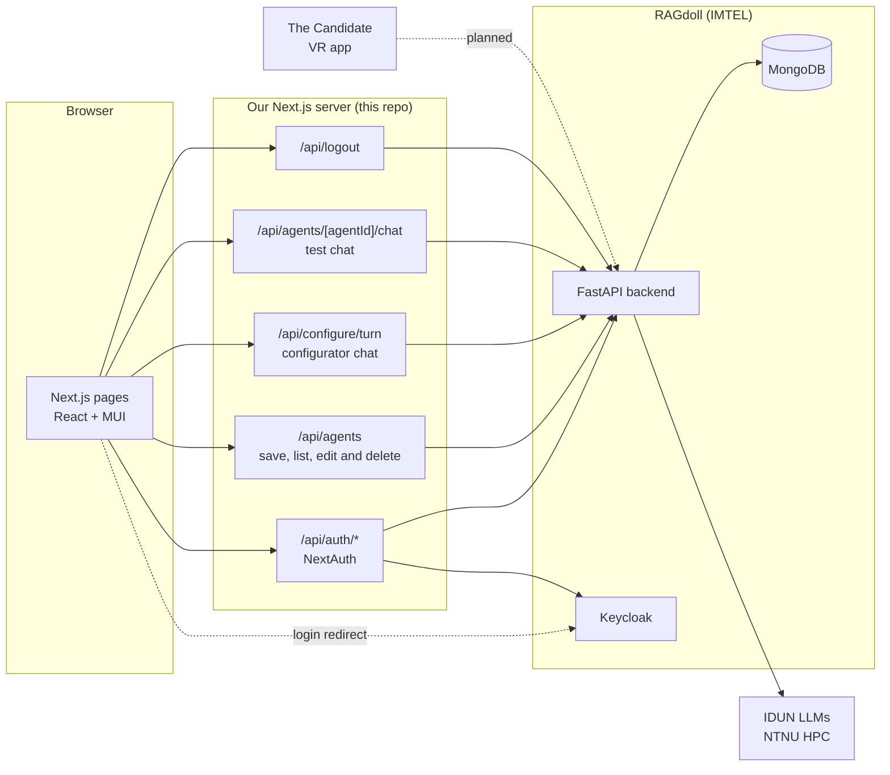
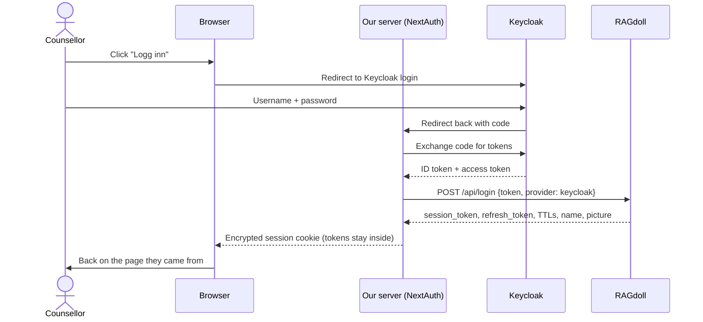
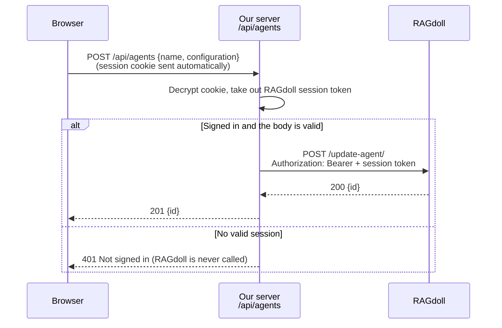
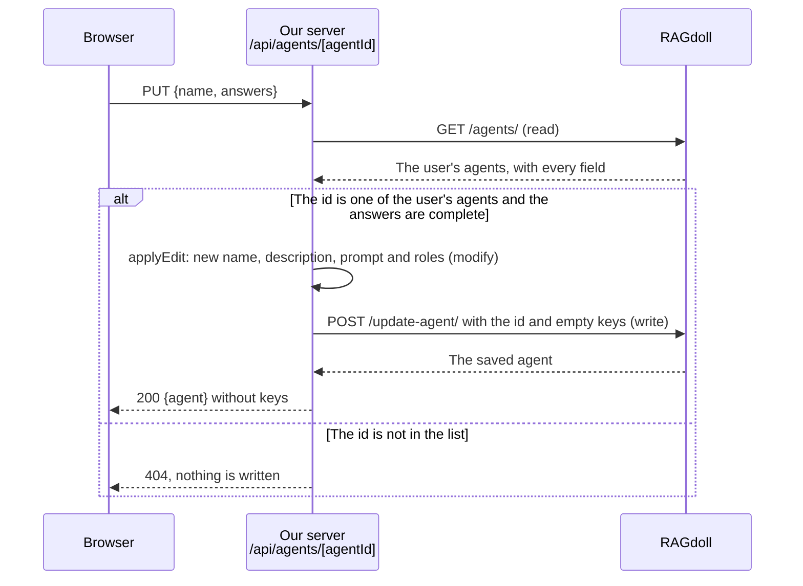
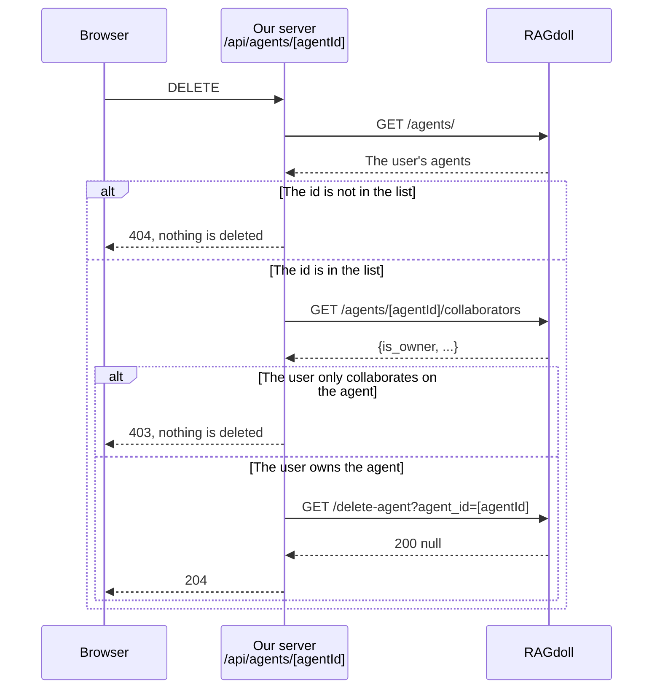
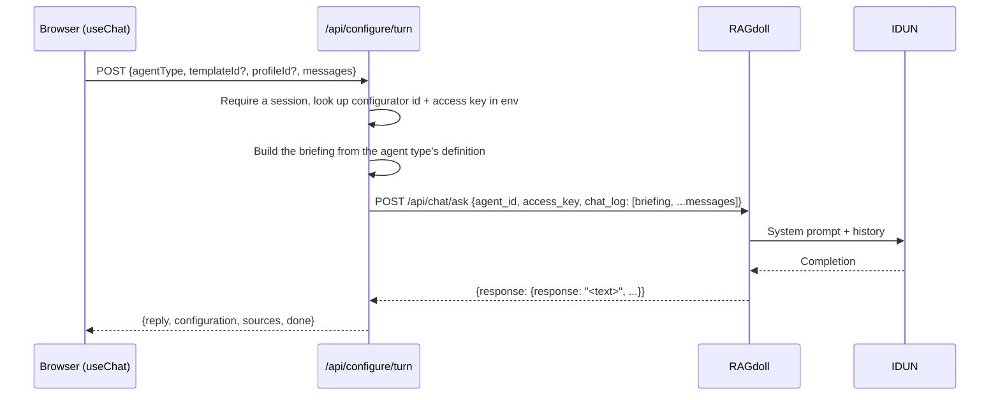
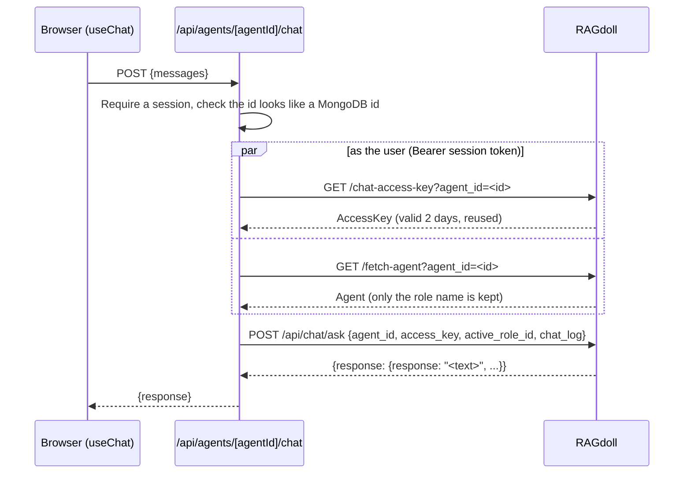

# Architecture

<!-- Overview of the system: our frontend, RAGdoll, IDUN and The Candidate. What each part does, how they talk to each other, and where agents and templates are stored. Feeds chapter 8 of the report. -->

This page describes how the system fits together: our frontend, RAGdoll, IDUN and The Candidate.
It separates what is **built** from what is **planned**, so check the status column before you
rely on a part. Why things look the way they do is recorded in [`decisions/`](decisions/).

## Contents

- [Overview](#overview)
- [The parts](#the-parts)
- [Inside the frontend](#inside-the-frontend)
- [Flows](#flows)
  - [Logging in](#logging-in)
  - [Calling RAGdoll as the user](#calling-ragdoll-as-the-user)
  - [Editing an agent](#editing-an-agent)
  - [Deleting an agent](#deleting-an-agent)
  - [Agent types](#agent-types)
  - [Chatting with an agent](#chatting-with-an-agent)
  - [Logging out](#logging-out)
- [Where agents, prompts and templates are stored](#where-agents-prompts-and-templates-are-stored)
- [Secrets and configuration](#secrets-and-configuration)
- [Error handling](#error-handling)
- [Open questions](#open-questions)

## Overview



Three rules hold the design together:

1. **The browser only talks to our own server** (and to Keycloak's login pages). It never calls
   RAGdoll directly, so no RAGdoll token or access key reaches the browser, and we need no CORS
   setup in RAGdoll.
2. **Only RAGdoll talks to IDUN.** Our server holds `IDUN_API_KEY` only to write it onto a new
   agent. The key is never sent to the browser and is never committed.
3. **RAGdoll is the source of truth for agents.** We store no agents of our own; The Candidate
   is meant to read the published agents from RAGdoll too.

## The parts

| Part                 | What it does                                                                                                         | Owned by                  | Status                          |
| -------------------- | -------------------------------------------------------------------------------------------------------------------- | ------------------------- | ------------------------------- |
| Frontend (this repo) | Web app for counsellors: log in, configure an agent in a chat, test it, browse agents. Next.js server + React pages. | Us                        | Built, in progress              |
| RAGdoll backend      | Stores agents, runs the chat pipeline (prompt + history → LLM), issues session tokens. Python, FastAPI.              | IMTEL (we may contribute) | Running, used as is             |
| Keycloak             | Login and registration. Ships with RAGdoll's Docker Compose (realm `ragdoll`, client `ragdoll-config`).              | IMTEL                     | Running                         |
| MongoDB              | RAGdoll's database: users, agents, documents.                                                                        | IMTEL                     | Running                         |
| IDUN                 | NTNU's HPC cluster that hosts the LLMs. Reached only through RAGdoll.                                                | NTNU                      | Running                         |
| The Candidate        | VR app where job seekers practise interviews with the published agent.                                               | IMTEL                     | Exists; integration not started |

Locally, RAGdoll, Keycloak and MongoDB run in RAGdoll's `docker-compose.local.yml`; see
[Running locally](../README.md#running-locally). The deployed RAGdoll is at
`https://iplvr.it.ntnu.no/backend`.

## Inside the frontend

The frontend is one Next.js 16 app (App Router). Pages are React server components by default;
anything interactive is a client component. Code that holds secrets runs only on the server.

| Layer            | Where                                                                                                                                              | What                                                                                                                                                                                                                                                                                                                                                                                                                                                                                                      |
| ---------------- | -------------------------------------------------------------------------------------------------------------------------------------------------- | --------------------------------------------------------------------------------------------------------------------------------------------------------------------------------------------------------------------------------------------------------------------------------------------------------------------------------------------------------------------------------------------------------------------------------------------------------------------------------------------------------- |
| Pages            | `src/app/*/page.tsx`                                                                                                                               | `/` start, `/login`, `/configure` (agent type, then template and profile choice, then industry template, then configuration chat), `/create-template` (save a template), `/templates/[templateId]/edit` (edit a saved template), `/profiles` (job seeker profiles: list, `new`, `[profileId]/edit`), `/test-chat?agent=<id>` (test chat), `/browse-agents` (agent list), `/browse-agents/[agentId]` (details), `/browse-agents/[agentId]/edit` (edit form), `/browse-agents/[agentId]/clone` (clone form) |
| Route guard      | `src/proxy.ts`                                                                                                                                     | Sends signed-out users to `/login` before `/configure`, `/create-template`, `/templates`, `/profiles`, `/test-chat` and `/browse-agents`                                                                                                                                                                                                                                                                                                                                                                  |
| Components       | `src/components/`                                                                                                                                  | Chat (`chat/`), login buttons (`login/`), template picker (`templates/`), agent cards and the agent type chooser (`agents/`), navbar, theme                                                                                                                                                                                                                                                                                                                                                               |
| Domain           | `src/domain/`                                                                                                                                      | `agentTypes/` defines each agent type (fields, questions, prompt, roles), the configurator's briefing and how the `KONFIGURASJON` block is read, and how answers are stored; `agentList.ts` builds the agent cards' sections, role and short line; `interviewerSummary.ts` writes the summary on the details page; `configuration.ts` has the interviewer's labels; `interviewerPrompt.ts` is the interviewer's prompt                                                                                    |
| Browser helpers  | `src/app/configure/api.ts`, `src/app/browse-agents/api.ts`, `src/lib/auth.ts`                                                                      | Sends the configuration chat, the save, edit and delete requests, and loads the agent list; sign-in, register and sign-out helpers                                                                                                                                                                                                                                                                                                                                                                        |
| Route handlers   | `src/app/api/`                                                                                                                                     | `auth/` (NextAuth), `configure/turn/` (configurator), `agents/` (save and list), `agents/[agentId]/` (edit and delete), `agents/[agentId]/clone/` (save a clone as a new agent), `agents/[agentId]/chat/` (test chat), `templates/` (list and save templates), `templates/[templateId]/` (read, edit and delete one), `profiles/` and `profiles/[profileId]/` (the same for job seeker profiles), `user-settings/`, `logout/`                                                                             |
| Integration      | `src/server/ragdoll.ts`, `src/server/agentMapper.ts`, `src/server/templateMapper.ts`, `src/server/profileMapper.ts`, `src/server/errorResponse.ts` | The only code that calls RAGdoll: chat, agents, templates, job seeker profiles and user settings. Maps answers and templates onto RAGdoll's models and turns failures into HTTP statuses                                                                                                                                                                                                                                                                                                                  |
| Server-only code | `src/lib/auth-options.ts`, `src/lib/session-tokens.ts`                                                                                             | NextAuth config and token exchange; reading and refreshing the session token                                                                                                                                                                                                                                                                                                                                                                                                                              |

The chat UI is our own (see [ADR 0001](decisions/0001-own-chat-component.md)). One component,
`AgentChat`, serves both chats; each page passes it a `send` function and a fixed greeting:

```
ConfigurationChat ─ sendTurn ─────────────── POST /api/configure/turn
TestChat ────────── sendToAgent(agentId) ─────── POST /api/agents/[agentId]/chat

Both use AgentChat → useChat (messages, waiting, error) → MessageList + ChatInput
```

`useChat` is a small reducer (idle → waiting → idle or error → retry). It aborts a pending request
when the user leaves the page or clicks **Start på nytt**.

## Flows

### Logging in

We use NextAuth v4 with the Keycloak provider, against RAGdoll's Keycloak. RAGdoll does not accept
Keycloak tokens on its other endpoints, so after login our server trades the Keycloak token for
RAGdoll's own session token.



- The tokens live in NextAuth's **encrypted JWT cookie**, encrypted with `NEXTAUTH_SECRET`. The
  browser's `useSession()` only sees the user's name and picture.
- RAGdoll's session token lasts 15 minutes. NextAuth's `jwt` callback refreshes it with
  `POST /api/refresh` when it is about to expire, and ends the session when the refresh token has
  expired too.
- Code: [`src/lib/auth-options.ts`](../src/lib/auth-options.ts).

### Calling RAGdoll as the user

Saving and listing the counsellor's agents goes through `/api/agents`. The browser never calls
RAGdoll. The route handler reads the session token from the cookie and sends it as
`Authorization: Bearer ...`. There is no generic proxy: each route checks its own body and strips
keys before the answer goes back. See [ADR 0002](decisions/0002-stateless-backend-for-frontend.md).



`GET /api/agents` lists the same user's agents and returns only `id`, `name`, `description`,
`lastUpdated` and the advanced settings (`llmModel`, `temperature`, `prompt`), plus what the agent cards and the filter read from the stored answers: `type`,
`typeLabel`, `stilling`, `bransje` and `vanskelighetsgrad` (null when the agent was not made in
this app). RAGdoll's copy of the IDUN key is dropped before the list leaves our server.

Code: [`src/app/api/agents/route.ts`](../src/app/api/agents/route.ts),
[`src/server/ragdoll.ts`](../src/server/ragdoll.ts).

A route handler can't update the cookie, so a token refreshed for this request is used for that
one request only. NextAuth's regular session polling stores a fresh token in the cookie.

### Editing an agent

The counsellor edits an agent on `/browse-agents/[agentId]/edit`, reached with **Rediger** on the
details page. The form shows the name and one field per answer. The fields come from the agent's
type, not from the page. Saving sends `PUT /api/agents/[agentId]` with `{name, answers}`.



The route reads, modifies and writes the whole agent, because of how RAGdoll's
`POST /update-agent/` behaves:

- **It replaces the whole agent.** Every field left out of the body is reset to its default
  (`context_aware_retrieval`, for example), so we send back every field we read.
- **An unknown id creates a new agent.** So we write only after finding the id among the user's
  agents. We read from `GET /agents/`, not `/fetch-agent`, because `/fetch-agent` answers 401 both
  for an expired session and for an agent that is someone else's or does not exist.
- **Empty keys keep the stored keys.** The decrypted keys we read are never sent back, and an
  update needs no `IDUN_API_KEY`.

The prompt is rebuilt from the answers on every save, so an edit also brings an older agent up to
the current prompt, unless the counsellor wrote it by hand (see below). RAGdoll lets both owners
and collaborators update an agent. This app has no way
to add collaborators, so in practice only the owner can edit.

Code: [`src/app/api/agents/[agentId]/route.ts`](../src/app/api/agents/[agentId]/route.ts),
[`src/server/agentMapper.ts`](../src/server/agentMapper.ts),
[`src/server/ragdoll.ts`](../src/server/ragdoll.ts).

### Advanced settings

Experienced counsellors can change three things beyond the configuration, both before saving
(under the save form in `/configure`) and on the edit page. The agent details page shows them
read-only.

| Setting        | Stored in RAGdoll as | Default                     | Checked by                                                 |
| -------------- | -------------------- | --------------------------- | ---------------------------------------------------------- |
| Language model | `llm_model`          | `openai/gpt-oss-120b`       | Must be one of the models `GET /api/models` lists          |
| Temperature    | `llm_temperature`    | 0.7 (RAGdoll's own default) | 0 to 2, at most two decimals                               |
| System prompt  | `prompt`             | Built from the answers      | Not empty, at most 20,000 characters, when written by hand |

- `GET /api/models` asks RAGdoll's `POST /get_models` with the project's IDUN key, which stays on
  the server. If RAGdoll cannot list the models, the default (and an agent's current model) can
  still be chosen. Any failure counts as "cannot list", 401 included: RAGdoll also answers 401
  when IDUN rejects the project's key, so it says nothing about the counsellor's login.
- Saving only asks RAGdoll for the list when the chosen model is neither the default nor the
  agent's current model. If the list cannot be loaded then, the save answers 502 instead of
  rejecting a model that may well be valid.
- A hand-written prompt is marked with `customPrompt: true` in the stored answers. While the mark is
  there, changing the answers does not rebuild the prompt; turning "Skriv systemprompten selv"
  off removes the mark and rebuilds it.
- Without `advanced` in the body, `POST /api/agents` uses the defaults and `PUT` keeps what the
  agent has.
- RAGdoll's chat pipeline only uses the temperature from `tdt4290/main` with the fix
  `fix/agent-temperature`; before that it stored the value but ignored it.
- A hand-written prompt does not get the guardrails of the built prompt (stay in role, never ask
  for personal data). The form reminds the counsellor; appending the guardrails always is an open
  decision.

Code: [`src/domain/advancedSettings.ts`](../src/domain/advancedSettings.ts),
[`src/components/agents/AdvancedSettingsFields.tsx`](../src/components/agents/AdvancedSettingsFields.tsx),
[`src/app/api/models/route.ts`](../src/app/api/models/route.ts),
[`src/server/models.ts`](../src/server/models.ts).

### Deleting an agent

The counsellor deletes an agent with **Slett** on the details page. A dialog asks first, and only
**Slett** in the dialog sends `DELETE /api/agents/[agentId]`. When it is done, the browser goes back
to `/browse-agents`, which loads the list without caching, so the agent is gone.



Two things about RAGdoll's `GET /delete-agent` shape the route:

- **It answers 401 to a collaborator.** Our adapter reads 401 as an expired session, so the user
  would be told they are logged out. We ask `/agents/[agentId]/collaborators` for `is_owner` first
  and answer 403 ourselves. This app has no way to add collaborators yet, but RAGdollConfig does.
- **It answers `null` when it succeeds.** `requestAsUser` normally treats that as a broken answer,
  so `deleteAgent` passes `allowEmpty`.

Deleting cannot be undone. RAGdoll also removes the agent from its collaborators' lists.

Code: [`src/app/api/agents/[agentId]/route.ts`](../src/app/api/agents/[agentId]/route.ts),
[`src/server/ragdoll.ts`](../src/server/ragdoll.ts),
[`src/app/browse-agents/[agentId]/DeleteAgentButton.tsx`](../src/app/browse-agents/[agentId]/DeleteAgentButton.tsx).

### Agent types

Everything that is special about one kind of agent lives in its **agent type definition** in
`src/domain/agentTypes/`: its name and description, its fields (each with the question the
configurator asks), what the configurator needs to know about it, which fields an interviewer template, a job seeker profile
and an industry template fill in (`presets`), how its prompt is built from the answers, how its summary is written, and its roles. The
interviewer (`interviewer.ts`) is the only type so far. Adding a type is one new file and one line
in `registry.ts`; the pages, the routes, the mapper and the configurator's prompt never name a type
or a field.

On `/configure` the counsellor first chooses the type (`AgentTypePicker`). `registry.ts` also lists
**planned** types, which the chooser shows as "Kommer snart" without letting them be chosen. Then
come the steps for the presets the type has: the interviewer template and job seeker profile
together, then the industry template, then the chat. The stepper on the page is built from them. The configurator is one
shared RAGdoll agent with a prompt that is the same for every type: on every turn,
`/api/configure/turn` sends a briefing built from the definition first (`buildBriefing` in
`configurator.ts`), with the questions in order, the type's own rules, and the exact
`KONFIGURASJON` block to end with. Fields a template or profile decided are left out of the
questions and the block, but the briefing lists them with their text under "Allerede bestemt", so
the configurator fits the rest to them: with an interviewer template and an industry template, it
asks about the company and the interview with both the interviewer and the job in mind. The
server fills those fields in from the templates and profile whatever the configurator writes, and
`parseAnswers` reads the block by the definition's labels. An industry template records no
source, since the edit form has no industry choice. The chosen type is sent
with the save (`POST /api/agents` `{name, type, configuration, sources}`). A request without a type
is read as an interviewer, so an old browser tab still works.

**Templates** belong to an agent type. A type with `presets.template` names the field a
template's text fills in, and the wording the template form and picker use for it
(`TemplateText`). On `/create-template` the counsellor picks the type in a "Type agent" dropdown,
with planned types shown but not choosable; the labels and help follow the type. The type is
stored as the template's RAGdoll `type`, and cannot be changed once the template is saved, since
agents remember which template their text came from. `GET /api/templates?agentType=<id>` lists one
type's templates, and the picker on `/configure` and the edit form's dropdown show only the
chosen type's. The configure route refuses a template of another type. Which types a counsellor
may use is decided in one place, `listAccessibleAgentTypes` in `registry.ts`: for now every
counsellor may use every type.

The details page shows the type, and the agent list groups the cards by type, with the type's name
on each card.

The answers are stored in the agent's `description` as `{type, version, answers, sources}`
(`storedAnswers.ts`). Agents saved before agent types existed have only the answers, and are read
as interviewers. Reading is lenient: a field the type got after the agent was saved comes back
empty, so the counsellor can fill it in. Saving is strict: every field needs an answer.

The **summary** at the top of the details page is a few sentences, and comes from the definition's
`buildSummary`, in the same way as the prompt: from the stored answers only. The interviewer's
(`interviewerSummary.ts`) has up to three sentences: who it is for (position and industry), what
kind of interview it is (type and level of difficulty) and who it is made for (the job seeker,
cut after a whole part if it is long). A sentence is left out when its answers are empty, and no
summary is shown for an agent we did not make. The summary describes the answers, so it does not
follow a system prompt that was edited by hand.

`sources` remembers which template or job seeker profile an answer came from, as
`{ <field>: { kind: 'template' | 'profile', id } }`. The text stays in `answers`, since the prompt
is built from it; the source only lets the edit and clone form show the template or profile. On
`/configure`, `/api/configure/turn` returns the sources with the finished configuration, since it
is what puts the template's and profile's text in the answers. A source is dropped when the
counsellor rewrites the text. If the template or profile has been changed or deleted since, the
form says so, and the source is kept as long as the text is, since it still tells where the text
came from. Edits to a template or profile never change existing agents. Agents saved before
sources existed have none.

### Chatting with an agent

The configurator chat talks to one shared agent. The test chat talks to the agent the counsellor
saved, named in the URL (`/test-chat?agent=<id>`). Before showing the chat, the page loads the
counsellor's agents (`GET /api/agents`) and checks that the id is one of them; if not (deleted,
never existed, or someone else's) it says the interviewer was not found.

| Agent                   | Used on                 | Route                             | Prompt source                                                                                            |
| ----------------------- | ----------------------- | --------------------------------- | -------------------------------------------------------------------------------------------------------- |
| configurator (shared)   | `/configure`            | `POST /api/configure/turn`        | [`prompts/configurator.nb.md`](../prompts/configurator.nb.md)                                            |
| the counsellor's agents | `/test-chat?agent=<id>` | `POST /api/agents/[agentId]/chat` | [`src/domain/interviewerPrompt.ts`](../src/domain/interviewerPrompt.ts), written when the agent is saved |



The test chat first asks RAGdoll, as the logged-in user, for the agent's chat key and role:



- The browser never sends an access key. The configurator's key stays in server-side env
  variables; a saved agent's chat key is fetched on each turn and never leaves our server.
- The whole history is sent on every turn; RAGdoll keeps no conversation state for us.
- The opening greeting is fixed text in the page (no LLM call) but is sent as the first assistant
  turn, so the agent does not greet again.
- `/api/configure/turn` also parses a `KONFIGURASJON` block. When `done` is true, the page shows
  the save form. After saving, the form links to the test chat for the new agent.
- RAGdoll answers 401 both for an expired session and for someone else's agent. The session has
  just been checked, so `/api/agents/[agentId]/chat` answers 404 `Agent not found` in that case.
- The test chat does everything on `BACKEND_API_URL`, the RAGdoll the agent was saved in: the
  chat key, the agent and `/api/chat/ask` (`askSavedAgent`). Only the configurator chat goes to
  `RAGDOLL_API_URL` (`askAgent`), because the shared configurator agent lives there. Two URLs is a
  stopgap ([#31](https://github.com/IMTEL/team-tdt4290-fall-2026/issues/31)).
- Code: [`src/app/api/configure/turn/route.ts`](../src/app/api/configure/turn/route.ts),
  [`src/app/api/agents/[agentId]/chat/route.ts`](../src/app/api/agents/[agentId]/chat/route.ts),
  [`src/server/ragdoll.ts`](../src/server/ragdoll.ts).

### Logging out

Clearing our cookie alone would leave the Keycloak session alive, and the next **Logg inn** would
sign the user straight back in. So logout has three steps:

1. The browser calls `POST /api/logout`. Our server revokes the RAGdoll session
   (`GET /api/logout` on RAGdoll) and builds Keycloak's end-session URL.
2. The browser clears the NextAuth cookie (`signOut({ redirect: false })`).
3. The browser goes to Keycloak's end-session URL, which redirects back to `/login`.

Keycloak only redirects back if the client allows it, which `npm run keycloak:setup` configures.
Code: [`src/app/api/logout/route.ts`](../src/app/api/logout/route.ts),
[`src/lib/auth.ts`](../src/lib/auth.ts).

## Where agents, prompts and templates are stored

| What                               | Stored where today                                                                                                                                                                                                                                                                                                                                                                                                                                                                                                                                                                                                                                                                         | Target                                                                  |
| ---------------------------------- | ------------------------------------------------------------------------------------------------------------------------------------------------------------------------------------------------------------------------------------------------------------------------------------------------------------------------------------------------------------------------------------------------------------------------------------------------------------------------------------------------------------------------------------------------------------------------------------------------------------------------------------------------------------------------------------------ | ----------------------------------------------------------------------- |
| Configurator prompt                | Source in `prompts/configurator.nb.md` in this repo; copied by hand into the agent's **General Agent Prompt** in RAGdoll                                                                                                                                                                                                                                                                                                                                                                                                                                                                                                                                                                   | Same: the repo is the source, RAGdoll holds a copy                      |
| Counsellors' interviewer agents    | RAGdoll (MongoDB), created by `POST /api/agents` and listed by `GET /api/agents`, owned by the logged-in counsellor. `/browse-agents` reads that list                                                                                                                                                                                                                                                                                                                                                                                                                                                                                                                                      | Same                                                                    |
| Configuration answers              | JSON `{type, version, answers, sources, customPrompt?}` in the saved agent's `description` (`src/domain/agentTypes/storedAnswers.ts`). Older agents have only the answers                                                                                                                                                                                                                                                                                                                                                                                                                                                                                                                  | A field of its own, if RAGdoll gets a `metadata` field                  |
| Templates (role, industry, ...)    | Built-in: four interviewer personas in `src/data/interviewer-templates.ts`, listed by agent type in `src/data/templates.ts`. Saved: each counsellor's own templates in RAGdoll's `templates` collection, visible only to them, with the agent type they are for as RAGdoll's `type` (`interviewer` so far, which older templates already have). `/configure` shows the chosen type's built-in templates first, then saved; the server fills the field the type's `presets.template` names (`Intervjuer`) from the chosen one. Industry: eight built-in general jobs, public or private, in `src/data/industry-templates.ts`; the server fills `Stilling` and `Bransje` from the chosen one | Same                                                                    |
| Published agents for The Candidate | Not yet                                                                                                                                                                                                                                                                                                                                                                                                                                                                                                                                                                                                                                                                                    | Agent marked as published in RAGdoll; The Candidate reads it from there |
| Users                              | Keycloak (login) and RAGdoll (user record, created on first `POST /api/login`)                                                                                                                                                                                                                                                                                                                                                                                                                                                                                                                                                                                                             | Same                                                                    |
| Job seeker profiles                | RAGdoll's `job_seeker_profiles` collection, each owned by one counsellor and visible only to them. Anonymous: a label, age range, experience, education, languages, practice areas and private notes. Chosen on `/configure`; the server fills `Jobbsøker` from it, without the notes                                                                                                                                                                                                                                                                                                                                                                                                      | Same                                                                    |
| User settings                      | RAGdoll, in the user record under the namespace `interview-configurator` (`GET`/`PUT /api/user-settings`). No settings are defined yet                                                                                                                                                                                                                                                                                                                                                                                                                                                                                                                                                     | Same                                                                    |
| Session                            | Encrypted NextAuth cookie in the browser                                                                                                                                                                                                                                                                                                                                                                                                                                                                                                                                                                                                                                                   | Same                                                                    |

We keep no database of our own. Real job seeker data is never stored: the configurator asks only
for coarse, non-identifying traits (age group, experience, language level).

## Secrets and configuration

All settings are environment variables, listed with dummy values in
[`.env.example`](../.env.example). None has the `NEXT_PUBLIC_` prefix, so none is bundled into the
browser code.

| Variable                                | Used by                                                      | Secret? |
| --------------------------------------- | ------------------------------------------------------------ | ------- |
| `BACKEND_API_URL`                       | Login, refresh, logout, `/api/agents/*` (test chat included) | No      |
| `RAGDOLL_API_URL`                       | `/api/configure/turn`                                        | No      |
| `RAGDOLL_CONFIGURATOR_AGENT_ID`         | `/api/configure/turn`                                        | No      |
| `RAGDOLL_CONFIGURATOR_ACCESS_KEY`       | `/api/configure/turn`                                        | Yes     |
| `IDUN_API_KEY`                          | `POST /api/agents` (written onto the saved agent)            | Yes     |
| `NEXTAUTH_URL`                          | NextAuth                                                     | No      |
| `NEXTAUTH_SECRET`                       | NextAuth (cookie encryption)                                 | Yes     |
| `KEYCLOAK_CLIENT_ID`, `KEYCLOAK_ISSUER` | NextAuth Keycloak provider                                   | No      |
| `KEYCLOAK_CLIENT_SECRET`                | NextAuth Keycloak provider                                   | Yes     |

`IDUN_API_KEY` is sent to RAGdoll only when an agent is created, and no route returns it. Editing
an agent keeps the keys RAGdoll already has. Threats and countermeasures
are in [`security.md`](security.md); how the app is deployed is in
[`deployment.md`](deployment.md).

## Error handling

Errors are translated at each boundary, so technical details stay in the server log and users see
short Norwegian messages:

| Boundary             | What happens                                                                                                                                                                                                                                                                               |
| -------------------- | ------------------------------------------------------------------------------------------------------------------------------------------------------------------------------------------------------------------------------------------------------------------------------------------ |
| RAGdoll → our server | `src/server/ragdoll.ts` turns failures into a `RagdollError` with a kind: `config`, `timeout` (30 s), `unreachable`, `bad-response`, `unauthorized` or `not-found`                                                                                                                         |
| Our server → browser | `/api/configure/turn` and `/api/agents/*` map each kind to a status (500, 504, 502, 502, 401, 404) and a fixed English message; RAGdoll's own text is never forwarded                                                                                                                      |
| Browser → user       | The browser helpers turn the status into a Norwegian message (for example "Assistenten brukte for lang tid på å svare" or "Fant ikke agenten"). The chats show it with a **Prøv igjen** button; the edit form shows it and keeps what was typed; the delete dialog shows it and stays open |

## Open questions

- **Agent per counsellor.** Today both chats use one shared configurator agent and one shared test
  interviewer. Creating, updating and publishing each counsellor's own agent through
  `/api/backend` replaces the hard-coded interviewer and the mock agent list.
- **Prompt builder.** Where the `KONFIGURASJON` block becomes a system prompt: in our server, or in
  RAGdoll.
- **Templates.** Counsellors can make, edit and delete their own templates, for any agent type
  with a template preset. Built-in templates are still maintained in the code; it is open whether
  IMTEL wants to edit them too.
- **Access to agent types.** Every counsellor may use every agent type, for configuring and for
  templates. If that should depend on the counsellor, `listAccessibleAgentTypes` in
  `registry.ts` is the one place to change; where the access is stored (RAGdoll's user settings or
  Keycloak roles) is not decided.
- **The Candidate.** How the VR app finds and loads a published agent (contact: Mathias, IMTEL).
- **RAGdoll changes.** Whether we need changes in RAGdoll, and on which branch (see the README).
- **Other scenarios.** The brief asks for an architecture that allows scenarios other than job
  interviews. Every scenario goes through [agent types](#agent-types), including the configurator
  chat, so a new scenario is one new type definition. Still open: which scenarios IMTEL wants
  first.
