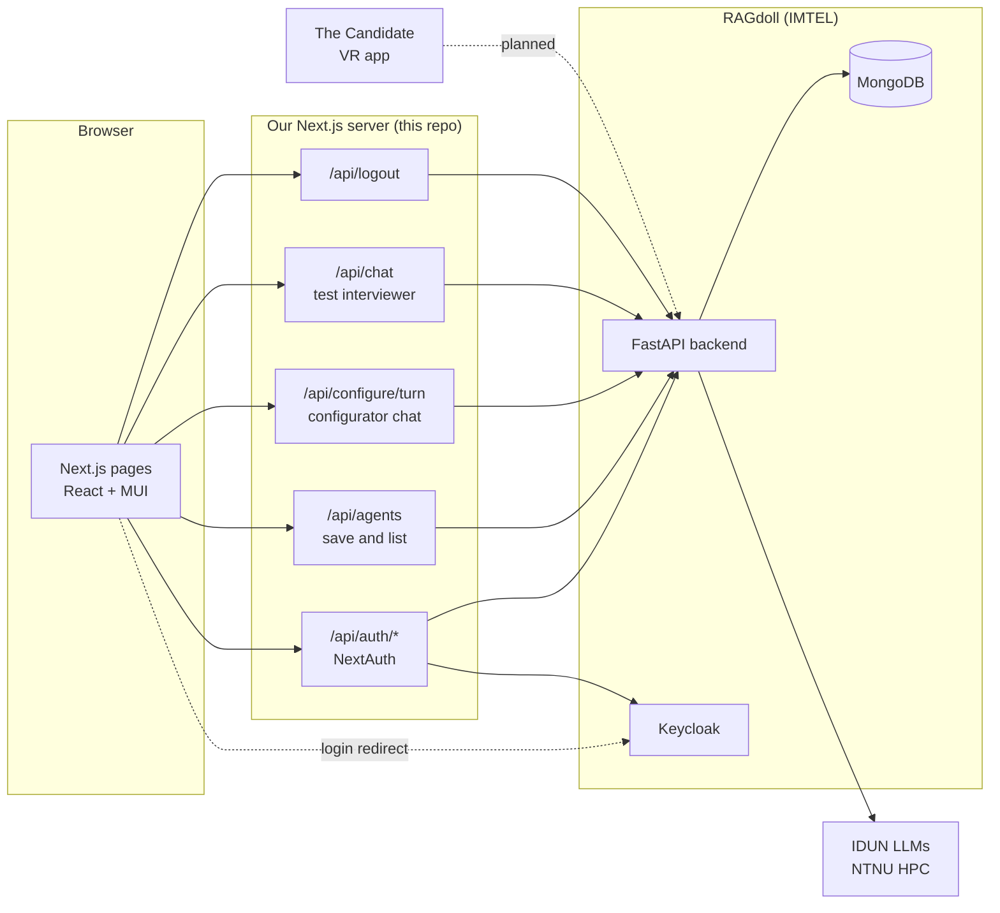
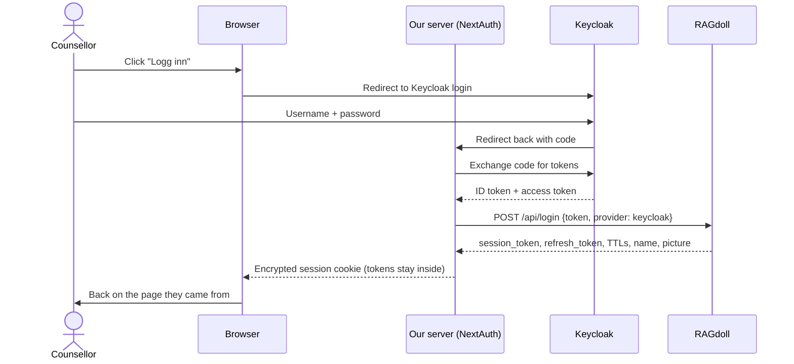
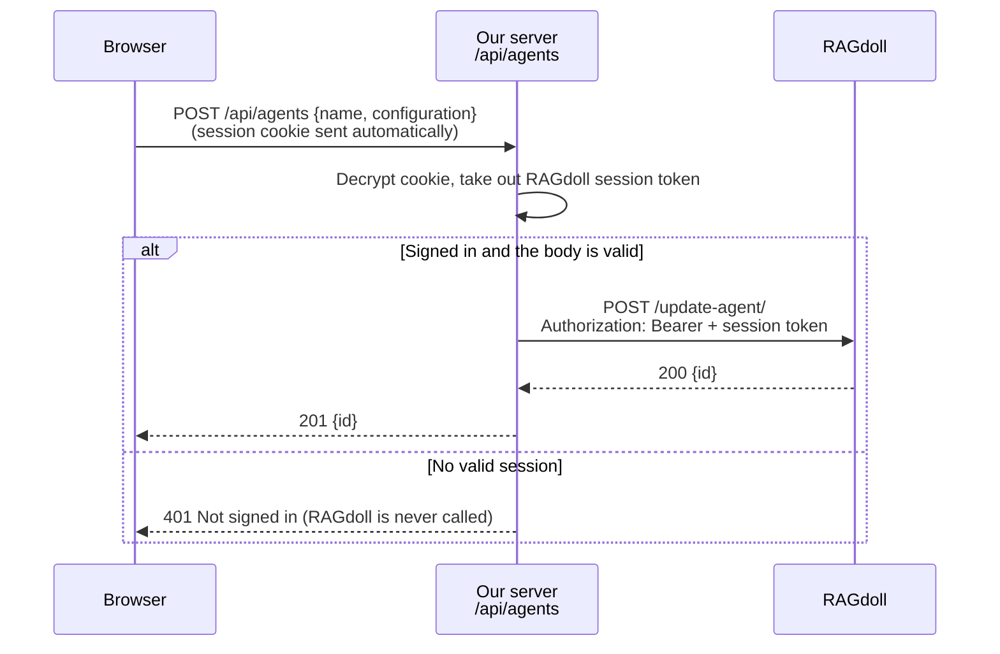
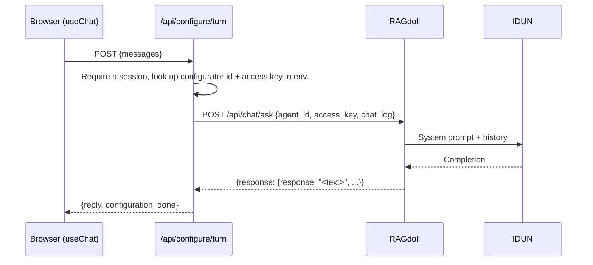

# Architecture

<!-- Overview of the system: our frontend, RAGdoll, IDUN and The Candidate. What each part does, how they talk to each other, and where agents and templates are stored. Feeds chapter 8 of the report. -->

This page describes how the system fits together: our frontend, RAGdoll, IDUN and The Candidate.
It separates what is **built** from what is **planned**, so check the status column before you
rely on a part. Why things look the way they do is recorded in [`decisions/`](decisions/).

## Contents

- [Overview](#overview)
- [The parts](#the-parts)
- [Inside the frontend](#inside-the-frontend)
- [Flows](#flows)
  - [Logging in](#logging-in)
  - [Calling RAGdoll as the user](#calling-ragdoll-as-the-user)
  - [Chatting with an agent](#chatting-with-an-agent)
  - [Logging out](#logging-out)
- [Where agents, prompts and templates are stored](#where-agents-prompts-and-templates-are-stored)
- [Secrets and configuration](#secrets-and-configuration)
- [Error handling](#error-handling)
- [Open questions](#open-questions)

## Overview



Three rules hold the design together:

1. **The browser only talks to our own server** (and to Keycloak's login pages). It never calls
   RAGdoll directly, so no RAGdoll token or access key reaches the browser, and we need no CORS
   setup in RAGdoll.
2. **Only RAGdoll talks to IDUN.** Our server holds `IDUN_API_KEY` only to write it onto a new
   agent. The key is never sent to the browser and is never committed.
3. **RAGdoll is the source of truth for agents.** We store no agents of our own; The Candidate
   is meant to read the published agents from RAGdoll too.

## The parts

| Part                 | What it does                                                                                                         | Owned by                  | Status                          |
| -------------------- | -------------------------------------------------------------------------------------------------------------------- | ------------------------- | ------------------------------- |
| Frontend (this repo) | Web app for counsellors: log in, configure an agent in a chat, test it, browse agents. Next.js server + React pages. | Us                        | Built, in progress              |
| RAGdoll backend      | Stores agents, runs the chat pipeline (prompt + history → LLM), issues session tokens. Python, FastAPI.              | IMTEL (we may contribute) | Running, used as is             |
| Keycloak             | Login and registration. Ships with RAGdoll's Docker Compose (realm `ragdoll`, client `ragdoll-config`).              | IMTEL                     | Running                         |
| MongoDB              | RAGdoll's database: users, agents, documents.                                                                        | IMTEL                     | Running                         |
| IDUN                 | NTNU's HPC cluster that hosts the LLMs. Reached only through RAGdoll.                                                | NTNU                      | Running                         |
| The Candidate        | VR app where job seekers practise interviews with the published agent.                                               | IMTEL                     | Exists; integration not started |

Locally, RAGdoll, Keycloak and MongoDB run in RAGdoll's `docker-compose.local.yml`; see
[Running locally](../README.md#running-locally). The deployed RAGdoll is at
`https://iplvr.it.ntnu.no/backend`.

## Inside the frontend

The frontend is one Next.js 16 app (App Router). Pages are React server components by default;
anything interactive is a client component. Code that holds secrets runs only on the server.

| Layer            | Where                                                                               | What                                                                                                                                       |
| ---------------- | ----------------------------------------------------------------------------------- | ------------------------------------------------------------------------------------------------------------------------------------------ |
| Pages            | `src/app/*/page.tsx`                                                                | `/` start, `/login`, `/configure` (configuration chat), `/template-picker`, `/test-chat` (interviewer chat), `/browse-agents` (agent list) |
| Route guard      | `src/proxy.ts`                                                                      | Sends signed-out users to `/login` before `/configure`, `/template-picker` and `/browse-agents`                                            |
| Components       | `src/components/`                                                                   | Chat (`chat/`), login buttons (`login/`), template picker (`templates/`), agent table (`agents/`), navbar, theme                           |
| Domain           | `src/domain/`                                                                       | `configuration.ts` reads the `KONFIGURASJON` block; `interviewerPrompt.ts` turns a configuration into the saved agent's prompt             |
| Browser helpers  | `src/app/configure/api.ts`, `src/lib/auth.ts`                                       | Sends the configuration chat and the save request; sign-in, register and sign-out helpers                                                  |
| Route handlers   | `src/app/api/`                                                                      | `auth/` (NextAuth), `configure/turn/` (configurator), `agents/` (save and list), `chat/` (test interviewer), `logout/`                     |
| Integration      | `src/server/ragdoll.ts`, `src/server/agentMapper.ts`, `src/server/errorResponse.ts` | The only code that calls RAGdoll: chat, save and list. Maps a configuration onto a RAGdoll agent and turns failures into HTTP statuses     |
| Server-only code | `src/lib/auth-options.ts`, `src/lib/session-tokens.ts`                              | NextAuth config and token exchange; reading and refreshing the session token                                                               |

The chat UI is our own (see [ADR 0001](decisions/0001-own-chat-component.md)). One component,
`AgentChat`, serves both chats; each page passes it a `send` function and a fixed greeting:

```
ConfigurationChat ─ sendTurn ─────────────── POST /api/configure/turn
TestChat ────────── sendToAgent('interviewer') ─ POST /api/chat

Both use AgentChat → useChat (messages, waiting, error) → MessageList + ChatInput
```

`useChat` is a small reducer (idle → waiting → idle or error → retry). It aborts a pending request
when the user leaves the page or clicks **Start på nytt**.

## Flows

### Logging in

We use NextAuth v4 with the Keycloak provider, against RAGdoll's Keycloak. RAGdoll does not accept
Keycloak tokens on its other endpoints, so after login our server trades the Keycloak token for
RAGdoll's own session token.



- The tokens live in NextAuth's **encrypted JWT cookie**, encrypted with `NEXTAUTH_SECRET`. The
  browser's `useSession()` only sees the user's name and picture.
- RAGdoll's session token lasts 15 minutes. NextAuth's `jwt` callback refreshes it with
  `POST /api/refresh` when it is about to expire, and ends the session when the refresh token has
  expired too.
- Code: [`src/lib/auth-options.ts`](../src/lib/auth-options.ts).

### Calling RAGdoll as the user

Saving and listing the counsellor's agents goes through `/api/agents`. The browser never calls
RAGdoll. The route handler reads the session token from the cookie and sends it as
`Authorization: Bearer ...`. There is no generic proxy: each route checks its own body and strips
keys before the answer goes back. See [ADR 0002](decisions/0002-stateless-backend-for-frontend.md).



`GET /api/agents` lists the same user's agents and returns only `id`, `name`, `description` and
`lastUpdated`. RAGdoll's copy of the IDUN key is dropped before the list leaves our server.

Code: [`src/app/api/agents/route.ts`](../src/app/api/agents/route.ts),
[`src/server/ragdoll.ts`](../src/server/ragdoll.ts).

A route handler can't update the cookie, so a token refreshed for this request is used for that
one request only. NextAuth's regular session polling stores a fresh token in the cookie.

### Chatting with an agent

The two chats talk to two fixed agents. The configurator is shared. The test interviewer is the
one named in the environment, not the agent the counsellor just saved.

| Agent          | Used on      | Route                      | Prompt source                                                 |
| -------------- | ------------ | -------------------------- | ------------------------------------------------------------- |
| `configurator` | `/configure` | `POST /api/configure/turn` | [`prompts/configurator.nb.md`](../prompts/configurator.nb.md) |
| `interviewer`  | `/test-chat` | `POST /api/chat`           | [`prompts/interviewer.nb.md`](../prompts/interviewer.nb.md)   |



- The browser does not send an agent id or an access key. Both stay in server-side env variables.
- The whole history is sent on every turn; RAGdoll keeps no conversation state for us.
- The opening greeting is fixed text in the page (no LLM call) but is sent as the first assistant
  turn, so the agent does not greet again.
- `/api/configure/turn` also parses a `KONFIGURASJON` block. When `done` is true, the page shows
  the save form.
- Both chats use the agent's access key, not the user's session token, and go to
  `RAGDOLL_API_URL`, which may differ from `BACKEND_API_URL` (login, refresh and `/api/agents`).
  Two URLs is a stopgap ([#31](https://github.com/IMTEL/team-tdt4290-fall-2026/issues/31)).
- Code: [`src/app/api/configure/turn/route.ts`](../src/app/api/configure/turn/route.ts),
  [`src/app/api/chat/route.ts`](../src/app/api/chat/route.ts),
  [`src/server/ragdoll.ts`](../src/server/ragdoll.ts).

### Logging out

Clearing our cookie alone would leave the Keycloak session alive, and the next **Logg inn** would
sign the user straight back in. So logout has three steps:

1. The browser calls `POST /api/logout`. Our server revokes the RAGdoll session
   (`GET /api/logout` on RAGdoll) and builds Keycloak's end-session URL.
2. The browser clears the NextAuth cookie (`signOut({ redirect: false })`).
3. The browser goes to Keycloak's end-session URL, which redirects back to `/login`.

Keycloak only redirects back if the client allows it, which `npm run keycloak:setup` configures.
Code: [`src/app/api/logout/route.ts`](../src/app/api/logout/route.ts),
[`src/lib/auth.ts`](../src/lib/auth.ts).

## Where agents, prompts and templates are stored

| What                                      | Stored where today                                                                                                                                                                               | Target                                                                  |
| ----------------------------------------- | ------------------------------------------------------------------------------------------------------------------------------------------------------------------------------------------------ | ----------------------------------------------------------------------- |
| Configurator and test interviewer prompts | Source in `prompts/*.nb.md` in this repo; copied by hand into each agent's **General Agent Prompt** in RAGdoll                                                                                   | Same: the repo is the source, RAGdoll holds a copy                      |
| Counsellors' interviewer agents           | RAGdoll (MongoDB), created by `POST /api/agents` and listed by `GET /api/agents`, owned by the logged-in counsellor. `/browse-agents` still shows mock data from `src/data/mock-agents.ts` (#28) | Same, and the browse page reads that list                               |
| Configuration answers                     | JSON in the saved agent's `description`, parsed from the `KONFIGURASJON` block by `src/domain/configuration.ts`                                                                                  | Same                                                                    |
| Templates (role, industry, ...)           | Four interviewer personas in `src/data/interviewer-templates.ts`. The choice stays on `/template-picker` and is not sent to the chat (#6)                                                        | To be decided: stay in this repo, or move to RAGdoll                    |
| Published agents for The Candidate        | Not yet                                                                                                                                                                                          | Agent marked as published in RAGdoll; The Candidate reads it from there |
| Users                                     | Keycloak (login) and RAGdoll (user record, created on first `POST /api/login`)                                                                                                                   | Same                                                                    |
| Session                                   | Encrypted NextAuth cookie in the browser                                                                                                                                                         | Same                                                                    |

We keep no database of our own. Real job seeker data is never stored: the configurator asks only
for coarse, non-identifying traits (age group, experience, language level).

## Secrets and configuration

All settings are environment variables, listed with dummy values in
[`.env.example`](../.env.example). None has the `NEXT_PUBLIC_` prefix, so none is bundled into the
browser code.

| Variable                                        | Used by                                           | Secret? |
| ----------------------------------------------- | ------------------------------------------------- | ------- |
| `BACKEND_API_URL`                               | Login, refresh, logout, `/api/agents`             | No      |
| `RAGDOLL_API_URL`                               | `/api/configure/turn`, `/api/chat`                | No      |
| `RAGDOLL_{CONFIGURATOR,INTERVIEWER}_AGENT_ID`   | `/api/configure/turn`, `/api/chat`                | No      |
| `RAGDOLL_{CONFIGURATOR,INTERVIEWER}_ACCESS_KEY` | `/api/configure/turn`, `/api/chat`                | Yes     |
| `IDUN_API_KEY`                                  | `POST /api/agents` (written onto the saved agent) | Yes     |
| `NEXTAUTH_URL`                                  | NextAuth                                          | No      |
| `NEXTAUTH_SECRET`                               | NextAuth (cookie encryption)                      | Yes     |
| `KEYCLOAK_CLIENT_ID`, `KEYCLOAK_ISSUER`         | NextAuth Keycloak provider                        | No      |
| `KEYCLOAK_CLIENT_SECRET`                        | NextAuth Keycloak provider                        | Yes     |

`IDUN_API_KEY` is sent to RAGdoll only when an agent is saved, and `GET /api/agents` never returns
it. Threats and countermeasures
are in [`security.md`](security.md); how the app is deployed is in
[`deployment.md`](deployment.md).

## Error handling

Errors are translated at each boundary, so technical details stay in the server log and users see
short Norwegian messages:

| Boundary             | What happens                                                                                                                                                                |
| -------------------- | --------------------------------------------------------------------------------------------------------------------------------------------------------------------------- |
| RAGdoll → our server | `src/server/ragdoll.ts` turns failures into a `RagdollError` with a kind: `config`, `timeout` (30 s), `unreachable` or `bad-response`                                       |
| Our server → browser | `/api/configure/turn`, `/api/chat` and `/api/agents` map each kind to a status (500, 504, 502, 502) and a fixed English message; RAGdoll's own text is never forwarded      |
| Browser → user       | The chat helpers turn the status into a `ChatError` with a Norwegian message (for example "Assistenten brukte for lang tid på å svare"), shown with a **Prøv igjen** button |

## Open questions

- **Agent per counsellor.** Today both chats use one shared configurator agent and one shared test
  interviewer. Creating, updating and publishing each counsellor's own agent through
  `/api/backend` replaces the hard-coded interviewer and the mock agent list.
- **Prompt builder.** Where the `KONFIGURASJON` block becomes a system prompt: in our server, or in
  RAGdoll.
- **Templates.** Where interviewer role and industry templates live, and who maintains them.
- **The Candidate.** How the VR app finds and loads a published agent (contact: Mathias, IMTEL).
- **RAGdoll changes.** Whether we need changes in RAGdoll, and on which branch (see the README).
- **Other scenarios.** The brief asks for an architecture that allows scenarios other than job
  interviews. Today the scenario lives entirely in the prompts and page texts, so a new scenario
  should mostly mean new prompts and a new agent pair.
