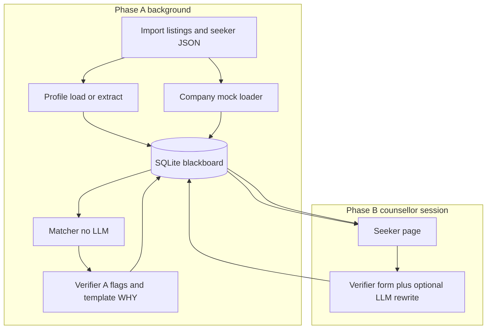

# Architecture

Counsellor-only demo: match synthetic job seekers to mock listings, then let a counsellor shrink the list with a few questions.

## What we keep from the original draft

Specialists still exist: **Profile**, **Matcher**, **Company**, **Verifier**. They share one store. The counsellor still gets a shortlist plus a **why** for each job. The system still runs in the background, then talks to the counsellor only when a case is opened.

## What we change

- **Not a classic blackboard.** A classic blackboard is a control loop where specialists decide *who runs next*. Our path is already known: extract → match → maybe ask. We use a **shared SQLite database + a background job**. In the report, call that store the blackboard. In the code, it is tables. See the [Nii blackboard notes](http://www.cs.cmu.edu/afs/cs/project/tinker-arch/www/html/1998/questions/20.Blackboard.html) vs a fixed workflow ([Anthropic: building effective agents](https://www.anthropic.com/engineering/building-effective-agents)).
- **Most “agents” are modules, not chatbots.** Only the Verifier talks to a human. Profile is one LLM extract (Sprint 4). Matcher has **no LLM**. Company in v1 **loads mock JSON**. No CrewAI/AutoGen group chat.
- **Score first, then explain.** Matcher writes numbers and feature hits. Night-time WHY is a **template** from those hits so the overnight job cannot invent skills. After counsellor questions, **one LLM rewrite** on leftover jobs only. Same idea as score-then-narrate in explainable job matching (e.g. JobMatchAI).
- **Company “scraper” is mocked.** IMTEL RAGdoll’s scraper chunks PDFs/HTML for RAG. It is not a company-website crawler. Glassdoor/Indeed scraping is out. Ten mock Norwegian employers with **opposite** culture tags so questions actually change the list.
- **RAGdoll is not the product.** Skip in v1. Do not ingest CVs or jobs into it.

**Report sentence.** Four specialist modules on a shared store; only the Verifier is an agent because only it must decide whether to ask a human.

## Two phases

**Phase A (no human).** Load or extract profile → Matcher scores (ignore culture) → Verifier A hard-drops only known clashes and `do_not_recommend` companies, flags unknown prefs, writes template WHY. Counsellor never waits.

**Phase B (human).** Counsellor opens seeker → sees ready list → one form of **at most 5** multiple-choice questions (stop if the list is already ≤3 or a flag would not split the list) → list shrinks on the same page → answers saved as `preference` rows → next night run reuses them. Skip does not become a stored fact. If the counsellor skips all questions, the Phase A list is still a working product.

## Modules (four people, four owners)

| Name | Job | LLM? | Agent? |
| --- | --- | --- | --- |
| **Orchestrator** | Queue, order, retries, status. Nobody chats. | No | No |
| **Profile** | One-shot: synthetic CV PDF → seeker row. Until Sprint 4, load mock JSON. | Yes, one call (Sprint 4) | No — pipeline |
| **Matcher** | Hard filters, then weighted score, store top-k + reason bullets. Ignores culture. | No | No — pipeline |
| **Company** | Load ~10 mock company JSON (5 culture traits + `shift_work` fact + caution + blurb). | No in v1 | No — pipeline |
| **Verifier** | Phase A: hard-drop + flags + template WHY. Phase B: ≤5 questions, shrink list, rewrite WHY, save answers. | WHY text only | **Yes — the only one** |

No Explainer module. No scraper agent. No supervisor LLM.

## Screens (counsellor only)

1. **Seeker list** — work queue with status.
2. **Seeker page** — compact profile, recommended jobs with WHY, question form on the same page. Company blurb lives on the job card, not a fourth screen.
3. **Import** — listings CSV/JSON; seekers as JSON in v1, PDF in Sprint 4.

No job-seeker login. No apply button. No NAV integration.

Statuses: `imported` / `profile_ready` / `matched` / `needs_questions` / `stale` / `error`.

## Stack

- Python 3.12, FastAPI, Jinja templates, one process
- SQLite (WAL) as the blackboard
- Worker: run on start + Refresh (APScheduler or equivalent)
- LLM client: LiteLLM or OpenAI-compatible `base_url` (Idun/OpenAI can swap)
- PyMuPDF in Sprint 4 for PDF text
- No vector DB, no Postgres, no Next.js, no Keycloak
- Streamlit only if Jinja eats Sprint 1

## RAGdoll (IMTEL)

Do **not** fork [IMTEL/RAGdoll](https://github.com/IMTEL/RAGdoll). It is a RAG **chat** product (Mongo, FAISS, Keycloak, `POST /api/chat/ask` at `https://iplvr.it.ntnu.no/backend`). There is no retrieve-only API. Do not put CVs on that host.

P2 only, after Phase B already works: counsellor Q&A over **public** company documents. Fallback is the mock company card already in SQLite. Matching and WHY stay in this app.

## Implementation order (vertical path)

1. Freeze schema + mock data + “decision support, synthetic data” banner.
2. Import listings + mock seeker JSON → Matcher writes top-k → counsellor sees a ready list.
3. Company JSON + Verifier Phase A (flags, template WHY, caution hard-drop).
4. Phase B questions that **visibly shrink** the list; persist prefs; grounding test.
5. Sprint 4: synthetic PDF → JSON extract, then rematch. If this slips, the demo still works from mock JSON.
6. Statuses, traces, demo script, report.

Cut order if time dies: RAGdoll helper → PDF extract → LLM WHY (keep template) → extra culture questions. **Do not cut** import, match list, or questions that shrink the list. PDF extract is the slip, not Verifier.

## Demo script (~8 minutes)

1. Import mock seekers/listings (or show they are already loaded). Hit Refresh. Status goes ready.
2. Open a seeker. Show top-k + WHY. Point at one skill that exists on the seeker. Point at one drop reason if any.
3. Answer 2–3 questions. List **visibly shrinks**. New WHY still only uses hits + answers. Open the store: preference persisted.
4. Say out loud: decision support, not auto-hire; data is synthetic; matcher is rules; LLM did extract and/or rewrite only.
5. Do **not** demo scrape, RAGdoll, or NAV.
