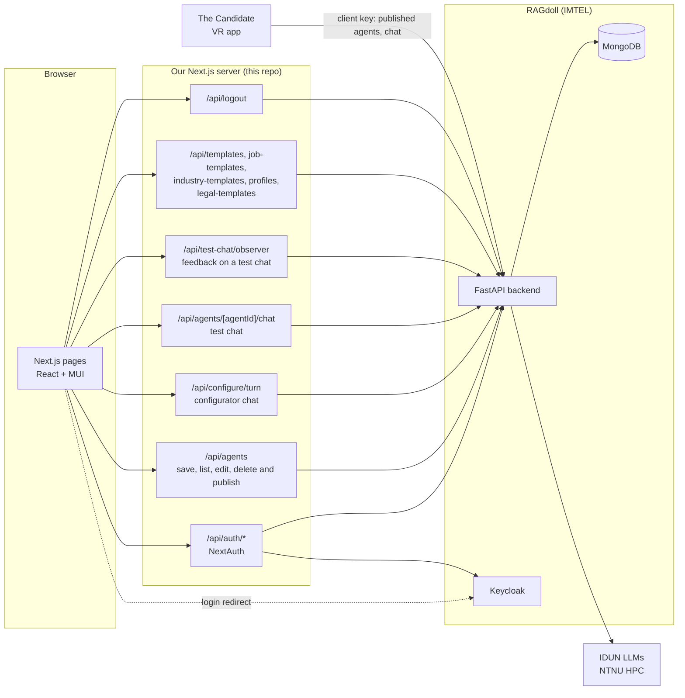
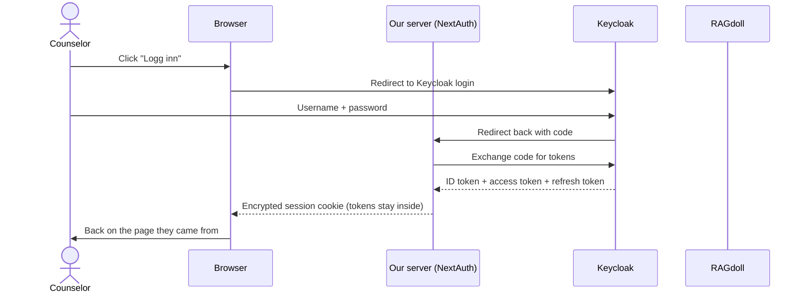
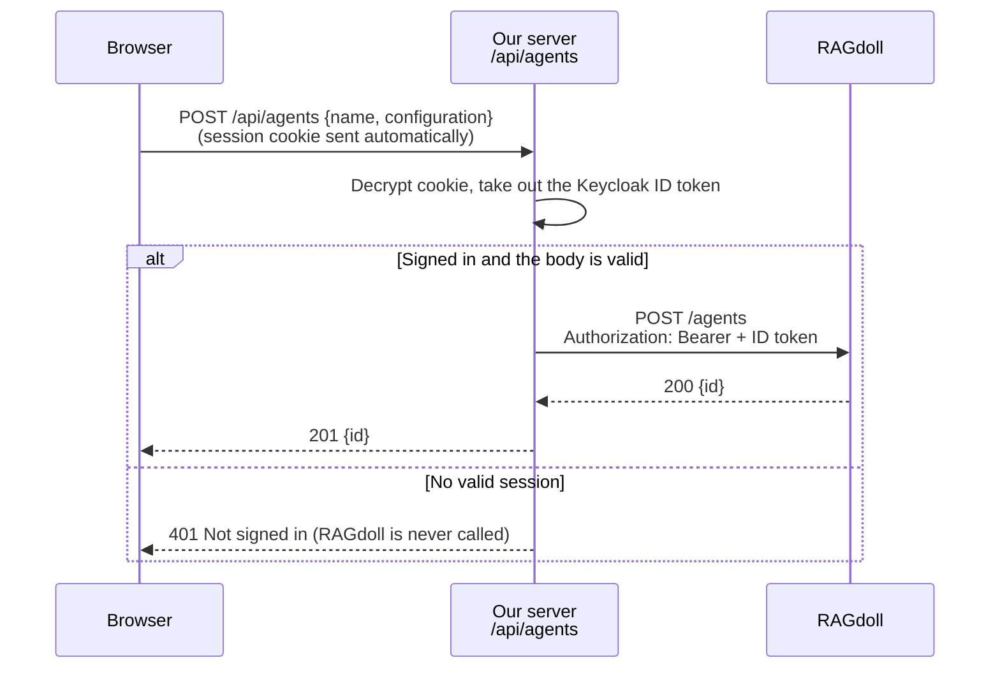
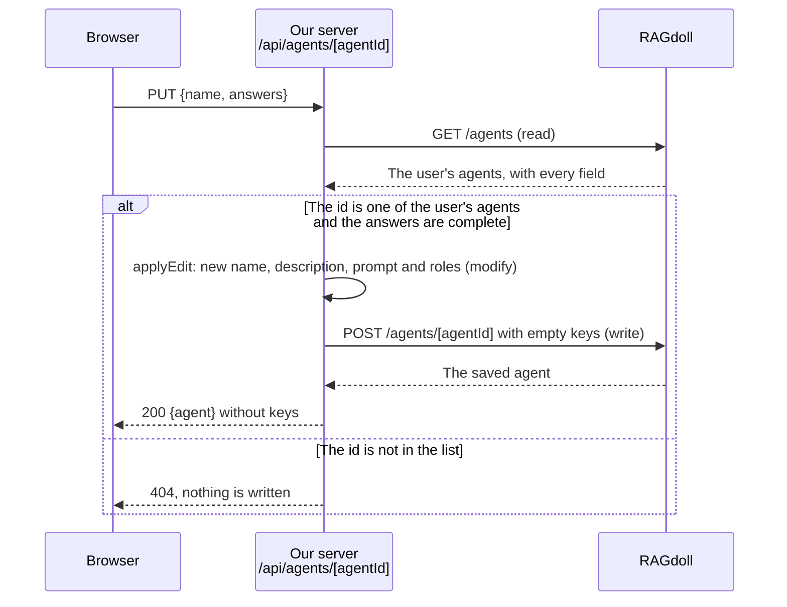
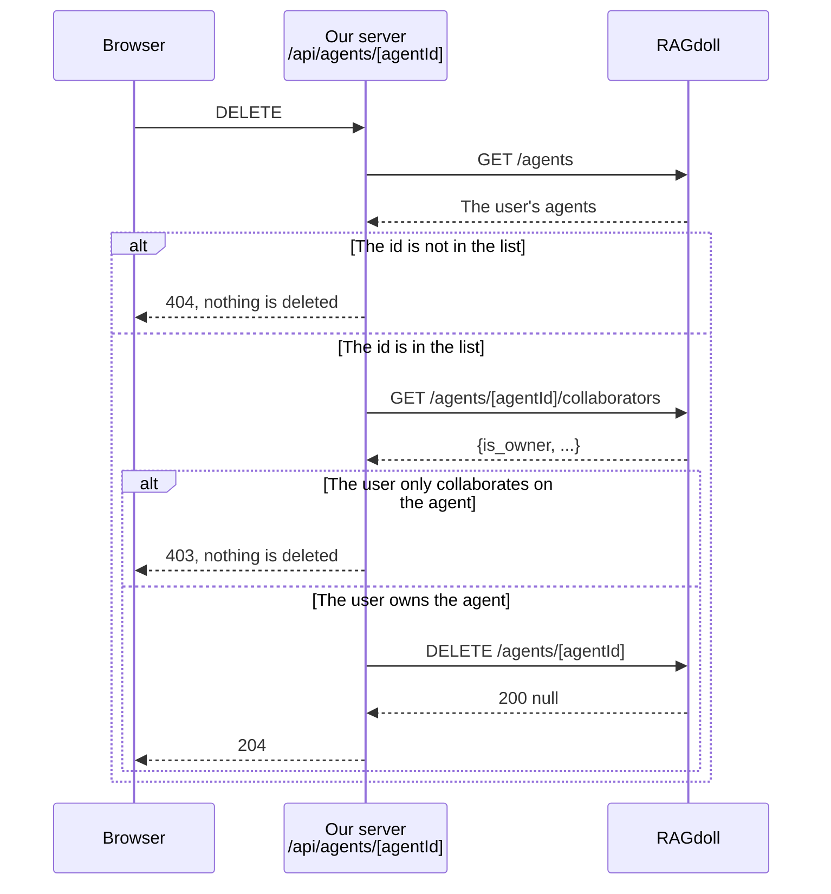
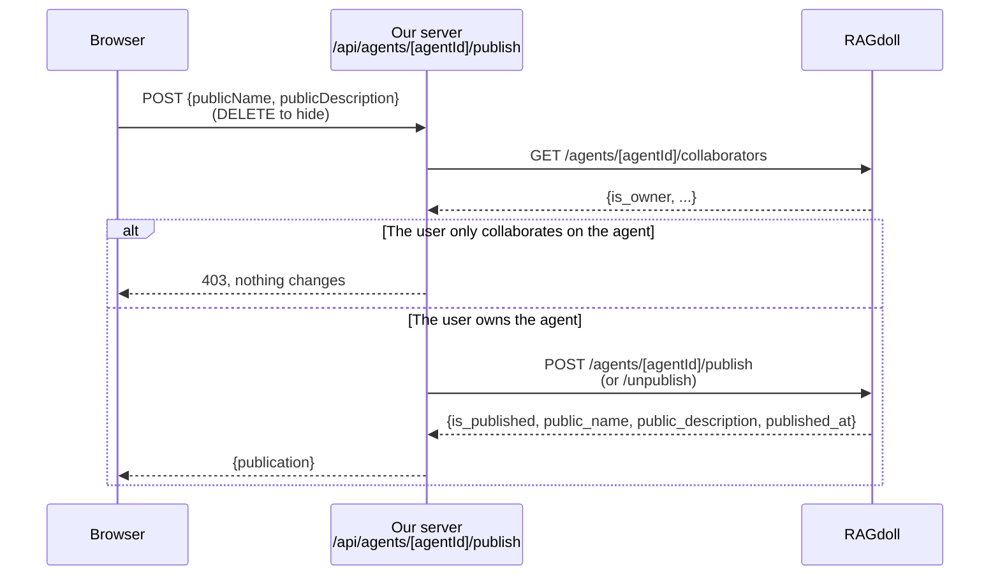
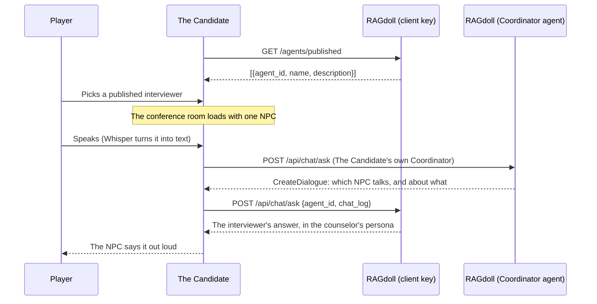
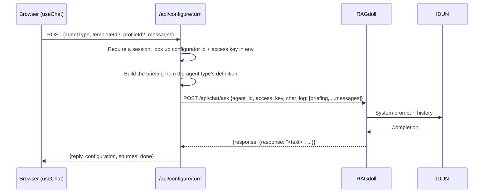
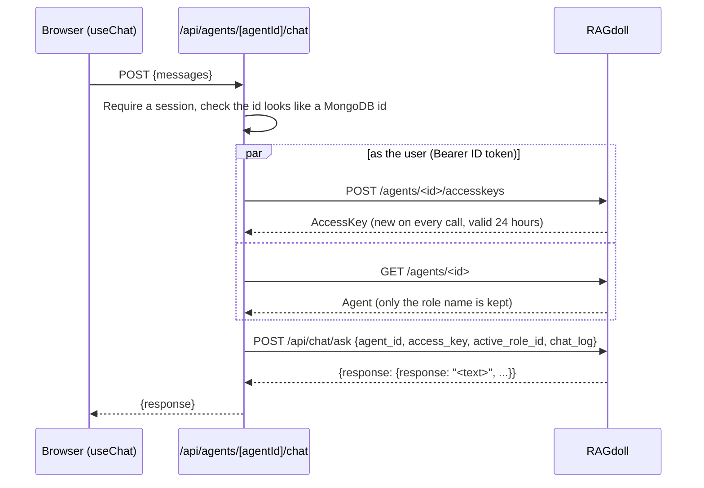

# Architecture

<!-- Overview of the system: our frontend, RAGdoll, IDUN and The Candidate. What each part does, how they talk to each other, and where agents and templates are stored. Feeds chapter 8 of the report. -->

This page describes how the system fits together: our frontend, RAGdoll, IDUN and The Candidate.
It separates what is **built** from what is **planned**, so check the status column before you
rely on a part. Why things look the way they do is recorded in [`decisions/`](decisions/).

## Contents

- [Overview](#overview)
- [The parts](#the-parts)
- [Inside the frontend](#inside-the-frontend)
- [Names in the app and in the code](#names-in-the-app-and-in-the-code)
- [Flows](#flows)
  - [Logging in](#logging-in)
  - [Calling RAGdoll as the user](#calling-ragdoll-as-the-user)
  - [Editing an agent](#editing-an-agent)
  - [Advanced settings](#advanced-settings)
  - [Deleting an agent](#deleting-an-agent)
  - [Publishing to The Candidate](#publishing-to-the-candidate)
  - [Agent types](#agent-types)
  - [Legal templates](#legal-templates)
  - [Chatting with an agent](#chatting-with-an-agent)
  - [Logging out](#logging-out)
- [Where agents, prompts and templates are stored](#where-agents-prompts-and-templates-are-stored)
- [Secrets and configuration](#secrets-and-configuration)
- [Error handling](#error-handling)
- [Open questions](#open-questions)

## Overview



Three rules hold the design together:

1. **The browser only talks to our own server** (and to Keycloak's login pages). It never calls
   RAGdoll directly, so no RAGdoll token or access key reaches the browser, and we need no CORS
   setup in RAGdoll.
2. **Only RAGdoll talks to IDUN.** Our server holds `IDUN_API_KEY` only to write it onto a new
   agent. The key is never sent to the browser and is never committed.
3. **RAGdoll is the source of truth for agents.** We store no agents of our own; The Candidate
   reads the published agents from RAGdoll too (see
   [Publishing to The Candidate](#publishing-to-the-candidate)).

## The parts

| Part                 | What it does                                                                                                        | Owned by                  | Status                          |
| -------------------- | ------------------------------------------------------------------------------------------------------------------- | ------------------------- | ------------------------------- |
| Frontend (this repo) | Web app for counselors: log in, configure an agent in a chat, test it, browse agents. Next.js server + React pages. | Us                        | Built, in progress              |
| RAGdoll backend      | Stores agents, runs the chat pipeline (prompt + history → LLM), checks Keycloak tokens. Python, FastAPI.            | IMTEL (we may contribute) | Running; we added publishing    |
| Keycloak             | Login and registration. Ships with RAGdoll's Docker Compose (realm `ragdoll`, client `ragdoll-config`).             | IMTEL                     | Running                         |
| MongoDB              | RAGdoll's database: users, agents, documents.                                                                       | IMTEL                     | Running                         |
| IDUN                 | NTNU's HPC cluster that hosts the LLMs. Reached only through RAGdoll.                                               | NTNU                      | Running                         |
| The Candidate        | VR app where job seekers practise interviews with the published agent.                                              | IMTEL                     | Lists and uses published agents |

Locally, RAGdoll, Keycloak and MongoDB run in RAGdoll's `docker-compose.local.yml`; see
[Running locally](../README.md#running-locally). The deployed RAGdoll is at
`https://iplvr.it.ntnu.no/backend`.

## Inside the frontend

The frontend is one Next.js 16 app (App Router). Pages are React server components by default;
anything interactive is a client component. Code that holds secrets runs only on the server.

| Layer            | Where                                                                                                                                                                                                                                                                                                                            | What                                                                                                                                                                                                                                                                                                                                                                                                                                                                                                                                                                                                                                                                                                                                                                                                                                                                                                                                                                                                                                                                                                                                                                                                                                                                                                                                                                                                                                                                                                       |
| ---------------- | -------------------------------------------------------------------------------------------------------------------------------------------------------------------------------------------------------------------------------------------------------------------------------------------------------------------------------- | ---------------------------------------------------------------------------------------------------------------------------------------------------------------------------------------------------------------------------------------------------------------------------------------------------------------------------------------------------------------------------------------------------------------------------------------------------------------------------------------------------------------------------------------------------------------------------------------------------------------------------------------------------------------------------------------------------------------------------------------------------------------------------------------------------------------------------------------------------------------------------------------------------------------------------------------------------------------------------------------------------------------------------------------------------------------------------------------------------------------------------------------------------------------------------------------------------------------------------------------------------------------------------------------------------------------------------------------------------------------------------------------------------------------------------------------------------------------------------------------------------------- |
| Pages            | `src/app/*/page.tsx`                                                                                                                                                                                                                                                                                                             | `/` start, `/login`, `/help` (open without logging in: short help in sections, reached from the question mark in the navbar and from «Les hjelpen for denne delen» in each wizard section, which links to `/help#<section>`; the text is in `src/app/help/helpTopics.ts`, the sections and their anchors in `src/app/configure/formSections.ts`), `/configure` (agent type, then for an interviewer a form wizard: stilling → intervjuer → jobbsøker → innstillinger → AI-innstillinger → fullføre), `/create-template` (save a template), `/templates` (Maler: stillings-, bransje- and jobbsøkermaler, and lovverk; the cards open the template's details page), `/templates/industries/[industry]` and `/templates/jobs/[jobId]` (bransje- and stillingsmaler: built-in ones read only, the counselor's own with edit and delete; `new` and `[...]/edit` for their own), `/templates/[templateId]` (an intervjuermal: details, with edit and delete for the counselor's own) and `/templates/[templateId]/edit`, `/profiles` (jobbsøkermaler: list, `new`, `[profileId]` details, `[profileId]/edit`), `/legal-templates` (lovverk: list, `new`, `[templateId]` details, `[templateId]/edit`), `/test-chat?agent=<id>`, `/browse-agents` (agent list, with a keyword search, filters, and a local Utkast card per draft), `/browse-agents/[agentId]` (details / edit / clone), `/profile` (Min profil: the counselor's name, picture, theme, agents and templates; reached from the name in the navbar) |
| Route guard      | `src/proxy.ts`                                                                                                                                                                                                                                                                                                                   | Sends signed-out users to `/login` before `/configure`, `/create-template`, `/templates`, `/profiles`, `/legal-templates`, `/test-chat` and `/browse-agents`. `/profile` is not in the list; the page itself asks a signed-out user to log in                                                                                                                                                                                                                                                                                                                                                                                                                                                                                                                                                                                                                                                                                                                                                                                                                                                                                                                                                                                                                                                                                                                                                                                                                                                              |
| Components       | `src/components/`                                                                                                                                                                                                                                                                                                                | Chat (`chat/`), login buttons (`login/`), template pickers and forms (`templates/`), legal template pickers and forms (`legalTemplates/`), job seeker profile forms (`profiles/`), agent cards including «Ny agent» and draft (`agents/`), navbar (Hjem, Agenter, Maler, and a question mark for Hjelp), theme                                                                                                                                                                                                                                                                                                                                                                                                                                                                                                                                                                                                                                                                                                                                                                                                                                                                                                                                                                                                                                                                                                                                                                                             |
| Domain           | `src/domain/`                                                                                                                                                                                                                                                                                                                    | `agentTypes/` defines each agent type (fields, questions, prompt, roles), the configurator's briefing and how the `KONFIGURASJON` block is read, and how answers are stored; `agentList.ts` builds the agent cards' sections, role and short line, and the keyword search over each agent's name and stored answers; `agentFilters.ts` the filters on Agenter (role, industry, sector, interview type, difficulty, status); `interviewerSummary.ts` writes the summary on the details page; `configuration.ts` has the interviewer's labels; `interviewerPrompt.ts` is the interviewer's prompt                                                                                                                                                                                                                                                                                                                                                                                                                                                                                                                                                                                                                                                                                                                                                                                                                                                                                                            |
| Browser helpers  | `src/app/configure/api.ts`, `wizardDraft.ts`, `wizardConfiguration.ts`, `src/app/browse-agents/api.ts`, `flash.ts`, `src/lib/auth.ts`                                                                                                                                                                                            | Sends the configuration chat and save requests; keeps an unfinished interviewer wizard in `localStorage`; one-shot toasts after redirect to Agenter; sign-in, register and sign-out helpers                                                                                                                                                                                                                                                                                                                                                                                                                                                                                                                                                                                                                                                                                                                                                                                                                                                                                                                                                                                                                                                                                                                                                                                                                                                                                                                |
| Route handlers   | `src/app/api/`                                                                                                                                                                                                                                                                                                                   | `auth/` (NextAuth), `configure/turn/` (configurator), `agents/` (save and list), `agents/[agentId]/` (edit and delete), `agents/[agentId]/clone/` (save a clone as a new agent), `agents/[agentId]/chat/` (test chat), `agents/[agentId]/feedback/` (rate a test chat reply and list the ratings) and `agents/[agentId]/feedback/[feedbackId]/` (undo a rating), `test-chat/observer/` (the observer's feedback on a test chat), `templates/` (list and save templates), `templates/[templateId]/` (read, edit and delete one), `profiles/` and `profiles/[profileId]/` (the same for job seeker profiles), `legal-templates/` and `legal-templates/[templateId]/` (the same for legal templates), `job-templates/` and `industry-templates/` (the same for stillings- and bransjemaler), `models/`, `user-settings/`, `logout/`                                                                                                                                                                                                                                                                                                                                                                                                                                                                                                                                                                                                                                                                           |
| Integration      | `src/server/ragdoll.ts`, `src/server/agentMapper.ts`, `src/server/templateMapper.ts`, `src/server/profileMapper.ts`, `src/server/legalTemplateMapper.ts`, `src/server/workplaceTemplateMapper.ts`, `src/server/feedbackMapper.ts`, `src/server/savedTemplateRoutes.ts`, `src/server/rateLimit.ts`, `src/server/errorResponse.ts` | The only code that calls RAGdoll: chat, agents, templates, job seeker profiles, legal templates, ratings and user settings. Maps answers and templates onto RAGdoll's models, limits chat messages per counselor, and turns failures into HTTP statuses                                                                                                                                                                                                                                                                                                                                                                                                                                                                                                                                                                                                                                                                                                                                                                                                                                                                                                                                                                                                                                                                                                                                                                                                                                                    |
| Server-only code | `src/lib/auth-options.ts`, `src/lib/session-tokens.ts`                                                                                                                                                                                                                                                                           | NextAuth config; reading and refreshing Keycloak's ID token, which RAGdoll takes as Bearer                                                                                                                                                                                                                                                                                                                                                                                                                                                                                                                                                                                                                                                                                                                                                                                                                                                                                                                                                                                                                                                                                                                                                                                                                                                                                                                                                                                                                 |

The chat UI is our own (see [ADR 0001](decisions/0001-own-chat-component.md)). One component,
`AgentChat`, serves both chats; each page passes it a `send` function and a fixed greeting:

```
ConfigurationChat ─ sendTurn ─────────────── POST /api/configure/turn
TestChat ────────── sendToAgent(agentId) ─────── POST /api/agents/[agentId]/chat

Both use AgentChat → useChat (messages, waiting, error) → MessageList + ChatInput
```

`useChat` is a small reducer (idle → waiting → idle or error → retry). It aborts a pending request
when the user leaves the page or clicks **Start på nytt**.

## Names in the app and in the code

The app speaks Norwegian and the code English, and some names drifted while the features grew.
Most surprising: a **stillingsmal** is an `IndustryTemplate` in the code, and a **bransjemal** is
an `IndustryTemplateEntry`. Look here before you search the code for something you saw on screen.

| In the app (Norwegian)    | In the code                                                         | Stored in RAGdoll as                                     | Built-in ones in                                                                   | API routes                       |
| ------------------------- | ------------------------------------------------------------------- | -------------------------------------------------------- | ---------------------------------------------------------------------------------- | -------------------------------- |
| Agent, intervjuer         | `Agent` (`src/lib/types.ts`), type `interviewer`                    | An agent; our answers as JSON in `description`           | –                                                                                  | `/api/agents`                    |
| Agenttype                 | `AgentTypeDefinition` (`src/domain/agentTypes/`)                    | Inside the stored answers (`type`)                       | `AGENT_TYPES` in `registry.ts`                                                     | –                                |
| Intervjuermal             | `AgentTemplate` (`src/data/templates.ts`)                           | A template with the agent type as `type` (`interviewer`) | `interviewerTemplates` in `src/data/interviewer-templates.ts`                      | `/api/templates`                 |
| Stillingsmal              | `IndustryTemplate` (`src/data/industry-templates.ts`)               | A template of type `job-template`                        | `industryTemplates` in `src/data/industry-templates.ts`                            | `/api/job-templates`             |
| Bransjemal                | `IndustryTemplateEntry` (`src/domain/workplaceTemplate.ts`)         | A template of type `industry-template`                   | – (the industries of the stillingsmaler count as built-in industries)              | `/api/industry-templates`        |
| Jobbsøkermal              | `JobSeekerProfile` (`src/domain/jobSeekerProfile.ts`)               | A profile (RAGdoll's `/profiles`)                        | –                                                                                  | `/api/profiles`                  |
| Lovverk                   | `LegalTemplate` (`src/domain/legalTemplate.ts`)                     | A template of type `legal-framework`                     | `builtInLegalParagraphs`, `standardLegalTemplate` in `src/data/legal-templates.ts` | `/api/legal-templates`           |
| Utkast                    | `WizardDraft` (`src/app/configure/wizardDraft.ts`)                  | Not in RAGdoll: `localStorage` key `kfi-configure-draft` | –                                                                                  | –                                |
| Bra / Dårlig (on a reply) | `MessageFeedback` (`src/domain/messageFeedback.ts`)                 | Feedback on the agent                                    | –                                                                                  | `/api/agents/[agentId]/feedback` |
| Be om tilbakemelding      | The observer, `ObserverFeedback` (`src/domain/observerFeedback.ts`) | Not stored                                               | –                                                                                  | `/api/test-chat/observer`        |
| Assistenten (the chat)    | The configurator (`src/domain/agentTypes/configurator.ts`)          | One shared agent                                         | –                                                                                  | `/api/configure/turn`            |
| Min profil                | `CounsellorProfile` (`src/domain/counsellorProfile.ts`)             | User settings, `profile`                                 | –                                                                                  | `/api/user-settings`             |
| Veileder                  | counselor (`counsellor` in older code)                              | The logged-in Keycloak user                              | –                                                                                  | –                                |
| Kandidat (in prompts)     | The job seeker in a transcript                                      | –                                                        | –                                                                                  | –                                |
| The Candidate             | The VR app, not a person                                            | Reads published agents with its client key               | –                                                                                  | –                                |

"Template" alone in the code usually means an intervjuermal (`AgentTemplate`, `src/components/templates/api.ts`), even though the folder `src/components/templates/` holds the forms for all of them.

## Flows

### Logging in

We use NextAuth v4 with the Keycloak provider, against RAGdoll's Keycloak. RAGdoll has no login
endpoint or session of its own: it checks the Keycloak **ID token** on every request (signature
against Keycloak's keys, audience = our client id, which is why the access token does not work). It
creates the user record the first time it sees a token.



- The tokens live in NextAuth's **encrypted JWT cookie**, encrypted with `NEXTAUTH_SECRET`. The
  browser's `useSession()` only sees the user's name and picture.
- The ID token lasts as long as Keycloak's access token lifespan. NextAuth's `jwt` callback
  refreshes it at Keycloak's token endpoint (`grant_type=refresh_token`) when it is about to expire,
  and ends the session when the refresh token has expired too.
- Code: [`src/lib/auth-options.ts`](../src/lib/auth-options.ts).

### Calling RAGdoll as the user

Saving and listing the counselor's agents goes through `/api/agents`. The browser never calls
RAGdoll. The route handler reads the ID token from the cookie and sends it as
`Authorization: Bearer ...`. There is no generic proxy: each route checks its own body and strips
keys before the answer goes back. See [ADR 0004](decisions/0004-stateless-backend-for-frontend.md).



`GET /api/agents` lists the same user's agents and returns only `id`, `name`, `description`,
`lastUpdated` and the advanced settings (`llmModel`, `temperature`, `maxTokens`, `prompt`), plus what the agent cards and the filter read from the stored answers: `type`,
`typeLabel`, `stilling`, `bransje` and `vanskelighetsgrad` (null when the agent was not made in
this app). RAGdoll's copy of the IDUN key is dropped before the list leaves our server.

Code: [`src/app/api/agents/route.ts`](../src/app/api/agents/route.ts),
[`src/server/ragdoll.ts`](../src/server/ragdoll.ts).

A route handler can't update the cookie, so a token refreshed for this request is used for that
one request only. NextAuth's regular session polling stores a fresh token in the cookie.

### Editing an agent

The counselor edits an agent on `/browse-agents/[agentId]/edit`, reached with **Rediger** on the
details page. The form shows the name and one field per answer. The fields come from the agent's
type, not from the page. Saving sends `PUT /api/agents/[agentId]` with `{name, answers}`.



The route reads, modifies and writes the whole agent, because of how RAGdoll's
`POST /agents/[agentId]` behaves:

- **It replaces the whole agent.** Every field left out of the body is reset to its default
  (`context_aware_retrieval`, for example), so we send back every field we read.
- **We write only after finding the id among the user's agents** (`GET /agents`), so an agent that
  is someone else's or does not exist gives a clear 404 before anything is sent. The list gives
  access keys only as metadata, so `access_key` is left out of the body; RAGdoll keeps the stored
  ones.
- **Empty keys keep the stored keys.** The decrypted keys we read are never sent back, and an
  update needs no `IDUN_API_KEY`.

The prompt is rebuilt from the answers on every save, so an edit also brings an older agent up to
the current prompt, unless the counselor wrote it by hand (see below). RAGdoll lets both owners
and collaborators update an agent. This app has no way
to add collaborators, so in practice only the owner can edit.

Code: [`src/app/api/agents/[agentId]/route.ts`](../src/app/api/agents/[agentId]/route.ts),
[`src/server/agentMapper.ts`](../src/server/agentMapper.ts),
[`src/server/ragdoll.ts`](../src/server/ragdoll.ts).

### Advanced settings

Experienced counsellors can change four things beyond the configuration, both before saving
(under the save form in `/configure`) and on the edit page. The agent details page shows them
read-only.

| Setting        | Stored in RAGdoll as | Default                      | Checked by                                                 |
| -------------- | -------------------- | ---------------------------- | ---------------------------------------------------------- |
| Language model | `llm_model`          | `openai/gpt-oss-120b`        | Must be one of the models `GET /api/models` lists          |
| Temperature    | `llm_temperature`    | 0.7 (RAGdoll's own default)  | 0 to 1.5, at most two decimals                             |
| Max tokens     | `llm_max_tokens`     | 1000 (RAGdoll's own default) | A whole number from 256 to 8000                            |
| System prompt  | `prompt`             | Built from the answers       | Not empty, at most 20,000 characters, when written by hand |

- `GET /api/models` asks RAGdoll's `POST /get_models` with the project's IDUN key, which stays on
  the server. If RAGdoll cannot list the models, the default (and an agent's current model) can
  still be chosen. Any failure counts as "cannot list", 401 included: RAGdoll also answers 401
  when IDUN rejects the project's key, so it says nothing about the counselor's login.
- Saving only asks RAGdoll for the list when the chosen model is neither the default nor the
  agent's current model. If the list cannot be loaded then, the save answers 502 instead of
  rejecting a model that may well be valid.
- A hand-written prompt is marked with `customPrompt: true` in the stored answers. While the mark is
  there, changing the answers does not rebuild the prompt; turning "Skriv systemprompten selv"
  off removes the mark and rebuilds it.
- Without `advanced` in the body, `POST /api/agents` uses the defaults and `PUT` keeps what the
  agent has.
- RAGdoll accepts temperatures up to 2, but from about 1.5 the model rarely stops on its own: it
  writes until it runs out of tokens and the chat times out after 30 s (#132). The max tokens count
  the model's reasoning too, so with only a few hundred the reply comes back empty. From a
  temperature above 1 or more than 2000 tokens, the form warns that replies can get much slower.
- RAGdoll's chat pipeline only uses the temperature from `tdt4290/main` with the fix
  `fix/agent-temperature`; before that it stored the value but ignored it.
- A hand-written prompt does not get the guardrails of the built prompt (stay in role, never ask
  for personal data). The form reminds the counselor; appending the guardrails always is an open
  decision.

Code: [`src/domain/advancedSettings.ts`](../src/domain/advancedSettings.ts),
[`src/components/agents/AdvancedSettingsFields.tsx`](../src/components/agents/AdvancedSettingsFields.tsx),
[`src/app/api/models/route.ts`](../src/app/api/models/route.ts),
[`src/server/models.ts`](../src/server/models.ts).

### Deleting an agent

The counselor deletes an agent with **Slett** on the details page. A dialog asks first, and only
**Slett** in the dialog sends `DELETE /api/agents/[agentId]`. When it is done, the browser goes back
to `/browse-agents`, which loads the list without caching, so the agent is gone.



Two things about RAGdoll's `DELETE /agents/[agentId]` shape the route:

- **It refuses a collaborator with a bare error.** That would not tell the user why. We ask `/agents/[agentId]/collaborators` for `is_owner` first
  and answer 403 ourselves. This app has no way to add collaborators yet, but RAGdollConfig does.
- **It answers `null` when it succeeds.** `requestAsUser` normally treats that as a broken answer,
  so `deleteAgent` passes `allowEmpty`.

Deleting cannot be undone. RAGdoll also removes the agent from its collaborators' lists.

Code: [`src/app/api/agents/[agentId]/route.ts`](../src/app/api/agents/[agentId]/route.ts),
[`src/server/ragdoll.ts`](../src/server/ragdoll.ts),
[`src/app/browse-agents/[agentId]/DeleteAgentButton.tsx`](../src/app/browse-agents/[agentId]/DeleteAgentButton.tsx).

### Publishing to The Candidate

A counselor makes an interviewer available in The Candidate (the VR app) with **Publiser** on the
agent's details page, and removes it again with **Gjem agent** (#96, #97). Publishing is a flag on
the agent in RAGdoll. We don't copy the agent anywhere, and the counselor never handles a key.

**Publishing and hiding.** The dialog asks for a public name (at most 80 characters) and a short
description (at most 300). It warns "Ikke skriv noe om jobbsøkeren her", because these two fields
are the only text The Candidate gets. Only the owner can publish or hide: a collaborator gets 403,
as with deleting.



RAGdoll stores `is_published`, `public_name`, `public_description` and `published_at` on the
agent. Only `/publish` and `/unpublish` change them, and creating or cloning an agent never
publishes it. **Editing a published agent hides it first** (#122): `PUT /api/agents/[agentId]`
calls `/unpublish` before it saves, so The Candidate never gets a version nobody has tested. Only
the owner may hide an agent, so only the owner may edit a published one. The details page then
says the agent was hidden because it changed. Hiding keeps the public name and description, so
publishing again starts from them.

**How The Candidate uses a published agent.** The Candidate has no login. It uses one shared
**client key**, `CANDIDATE_CLIENT_KEY` in RAGdoll's environment and `CANDIDATE` in The
Candidate's `.env`, sent as `Authorization: Bearer`. RAGdoll accepts that key in exactly two
places:

| Call                                        | What it gives The Candidate                                                                                                                                         |
| ------------------------------------------- | ------------------------------------------------------------------------------------------------------------------------------------------------------------------- |
| `GET /agents/published`                     | `[{agent_id, name, description}]` for every published agent. `name` and `description` are the public ones. No prompt, no job seeker answers, no role names, no keys |
| `POST /api/chat/ask` (and the speech chats) | A chat with a **published** agent, as its first role, or with the observer agent named in `CANDIDATE_OBSERVER_AGENT_ID`. Any other agent answers 403 at once        |

The key is deliberately not accepted anywhere else, so it can't read an agent's configuration
(`GET /agents/[agentId]` answers 403).



The Candidate still uses its own **Coordinator** agent (on the deployed RAGdoll) to decide who
talks. Our published agent only writes what the interviewer NPC says. The picker, the spawning of
the one NPC and the RAGdoll calls are in The Candidate's `InterviewerSelectionManager`,
`SpawnManager` and `PublishedRagService`.

**Feedback in VR** (#118). «Avslutt intervju» in The Candidate's pause menu ends the interview and
asks the same shared observer agent as our test chat for feedback, with the client key
(`PublishedRagService.AskObserver`). RAGdoll lets the client key chat with that one agent through
`CANDIDATE_OBSERVER_AGENT_ID` (IMTEL/RAGdoll#164); the observer is not published, so it never shows
in the list of interviewers. The Candidate builds the transcript, reads the `Bra:` / `Bedre:` /
`For kort:` lines and drops invented quotes in `ObserverFeedback.cs`, a copy of
[`src/domain/observerFeedback.ts`](../src/domain/observerFeedback.ts) (IMTEL/The-Candidate#39).
Nothing from the interview is kept.

Why it works this way, and what we chose not to do, is in
[decision 0003](decisions/0003-publish-to-the-candidate.md). How to test the whole flow on your
own machine, Unity included: [`testing-publish-to-the-candidate.md`](testing-publish-to-the-candidate.md).

Code: [`src/app/api/agents/[agentId]/publish/route.ts`](../src/app/api/agents/[agentId]/publish/route.ts),
[`src/server/ragdoll.ts`](../src/server/ragdoll.ts),
[`src/app/browse-agents/[agentId]/PublishAgentButton.tsx`](../src/app/browse-agents/[agentId]/PublishAgentButton.tsx),
[`src/domain/publication.ts`](../src/domain/publication.ts). In RAGdoll: `src/routes/agents.py`
(`/publish`, `/unpublish`, `/published`), `src/routes/chat.py` (`_authorize_command`) and
`src/access_service/candidate_client.py`.

### Agent types

Everything that is special about one kind of agent lives in its **agent type definition** in
`src/domain/agentTypes/`: its name and description, its fields (each with the question the
configurator asks), what the configurator needs to know about it, which fields an interviewer template, a job seeker profile
and an industry template fill in (`presets`), how its prompt is built from the answers, how its summary is written, and its roles. The
interviewer (`interviewer.ts`) is the only type so far. The routes, the mapper, the storage and the
configurator's prompt never name a type or a field. The six-step form wizard on `/configure` is
still written for the interviewer only. Every new type should get the same steps with its own
content, which first needs the interviewer's steps moved behind a per-type wizard. Until then a
new type falls back to the configuration chat. The start page and a few lists also name
`'interviewer'`. The full checklist for a new type is in
[`extending.md`](extending.md#add-a-new-agent-type).

On `/configure` the counselor first chooses the type (`AgentTypePicker`). `registry.ts` also lists
**planned** types, which the chooser shows as "Kommer snart" without letting them be chosen.

For an **interviewer**, setup is a form wizard, not the configuration chat
([decision 0005](decisions/0005-form-wizard-instead-of-configuration-chat.md)): Stilling og
arbeidsplass → Intervjuer (template + legal templates) → Jobbsøker (jobbsøkermal + practice areas)
→ Innstillinger → AI-innstillinger (model, temperature and max tokens, optional) → Fullføre. The chosen
templates are shown as bubbles beside the steps (`TemplatePeekBubbles`, `templatePeeks.ts`), and
fields have a question mark with a short explanation (`FieldHelp`).

- **Saving.** **Publiser**, **Lagre som privat agent** and **Test agenten** all build the answer
  fields in the browser (`wizardConfiguration.ts`) and save with `POST /api/agents`, with the
  model, temperature and max tokens as advanced settings. **Publiser** first asks for the public name and
  description (`PublishToCandidateDialog`, shared with the details page), then publishes the saved
  agent with `POST /api/agents/[agentId]/publish`. If publishing fails, the agent stays saved as
  private. A hand-written system prompt is only possible in the edit form, not in the wizard.
- **Drafts.** **Lagre utkast** keeps progress in `localStorage` (`wizardDraft.ts`) and opens
  `/browse-agents`. Each wizard has its own draft id in the URL (`/configure?type=interviewer&draft=<id>`),
  so a counselor can keep several drafts; each shows as an **Utkast** card that resumes at the
  step it was left on, or deletes it. Saving a finished agent clears its draft and shows a short
  toast («Agent lagret» or «Agent publisert»). **Ny agent** on the start page opens
  `&new=1`, which always starts a new draft.
- **Leaving.** `LeaveWizardGuard` asks «Forlate uten å lagre?» before a link takes the counselor
  away from the wizard. Links that come back (`returnTo`, such as «Lag en ny mal») are let through.

The UI says _jobbsøkermal_; RAGdoll and the code still use _job seeker profile_.

Other agent types (when added) can still use preset pickers and `ConfigurationChat`. That chat
calls a shared RAGdoll configurator: on every turn `/api/configure/turn` sends a briefing
(`buildBriefing` in `configurator.ts`) and may end with a `KONFIGURASJON` block that
`parseAnswers` reads. Fields a template or profile decided are left out of the questions and the
block, but listed under "Allerede bestemt". The server fills those fields from the templates and
profile whatever the configurator writes. An industry template records no source, since the edit
form has no industry choice. The chosen type is sent with the save
(`POST /api/agents` `{name, type, configuration, sources}`). A request without a type is read as an
interviewer, so an old browser tab still works.

**Templates** belong to an agent type. A type with `presets.template` names the field a
template's text fills in, and the wording the template form and picker use for it
(`TemplateText`). On `/create-template` the counselor picks the type in a "Type agent" dropdown,
with planned types shown but not choosable; the labels and help follow the type. The type is
stored as the template's RAGdoll `type`, and cannot be changed once the template is saved, since
agents remember which template their text came from. `GET /api/templates?agentType=<id>` lists one
type's templates, and the picker on `/configure` and the edit form's dropdown show only the
chosen type's. The configure route refuses a template of another type. Which types a counselor
may use is decided in one place, `listAccessibleAgentTypes` in `registry.ts`: for now every
counselor may use every type.

The details page shows the type, and the agent list groups the cards by type, with the type's name
on each card.

The answers are stored in the agent's `description` as `{type, version, answers, sources}`, with
`customPrompt` and `avatar` added only when set (`storedAnswers.ts`). Agents saved before agent types existed have only the answers, and are read
as interviewers. Reading is lenient: a field the type got after the agent was saved comes back
empty, so the counselor can fill it in. Saving is strict: every field needs an answer.

The **summary** at the top of the details page is a few sentences, and comes from the definition's
`buildSummary`, in the same way as the prompt: from the stored answers only. The interviewer's
(`interviewerSummary.ts`) has up to three sentences: who it is for (position and industry), what
kind of interview it is (type and level of difficulty) and who it is made for (the job seeker,
cut after a whole part if it is long). A sentence is left out when its answers are empty, and no
summary is shown for an agent we did not make. The summary describes the answers, so it does not
follow a system prompt that was edited by hand.

In a box under the summary, and on the wizard's last step, **«Slik former svarene dine agenten»** lists
which answers change how the agent behaves, and how. It comes from the definition's
`explainAnswers`. For the interviewer, `interviewerAdaptations.ts` has one rule per answer, and
each rule gives both the line it adds to the prompt and the sentence the counselor sees. The
prompt's «Slik gjennomfører du intervjuet» section is built from the same rules, so the list
never promises a change the prompt does not make; a test checks that every instruction is in the
prompt. Answers that change nothing, such as «ingen» own questions, are left out. When the system
prompt was written by hand, the list is replaced by a note that the answers change nothing.
`avatar` is the id of the agent's avatar, such as `ugle`. IDUN has no model that makes images, so
the counselor picks one of the ready-made images in `public/avatars/`, listed in
`src/domain/avatars.ts`, and only the id is saved. RAGdoll has no field for it, but it keeps
`description` as it is and never sends it to the model. An agent without an avatar, or with an id we
no longer have, shows `public/avatars/default.svg`. An update without `avatar` keeps the agent's
avatar, `null` goes back to the default image, and a clone without `avatar` gets the original's.

`sources` remembers which template or job seeker profile an answer came from, as
`{ <field>: { kind: 'template' | 'profile', id } }`, or which legal templates, as
`{ kind: 'legal', ids }` (see [Legal templates](#legal-templates)). The text stays in `answers`, since the prompt
is built from it; the source only lets the edit and clone form show the template or profile. On
`/configure`, `/api/configure/turn` returns the sources with the finished configuration, since it
is what puts the template's and profile's text in the answers. A source is dropped when the
counselor rewrites the text. If the template or profile has been changed or deleted since, the
form says so, and the source is kept as long as the text is, since it still tells where the text
came from. Edits to a template or profile never change existing agents. Agents saved before
sources existed have none.

### Legal templates

A legal template is a law or rule about hiring, written in plain words by a counselor: what an
employer may not ask about in a job interview, and what rights the job seeker has. On
`/configure` the counselor ticks whole templates in the wizard's intervjuer step, under the
interviewer template. A new interviewer starts with the standard template, which includes every
built-in paragraph. To drop some laws, the counselor makes their own template and unticks the
ones they want to discard. The interviewer follows the chosen text, and if the job seeker asks
about their rights, it answers briefly from that text only.

- **Stored as RAGdoll templates** with the type `legal-framework`, so RAGdoll needed no change.
  `content` is `{text}` and may include `sourceIds` for the ticked paragraphs. The routes in
  `/api/legal-templates` only read, change or delete templates of that type, so they never touch
  an agent type's templates.
- **Built-in paragraphs**, one per law (`src/data/legal-templates.ts`): Norwegian hiring rules
  (likestillings- og diskrimineringsloven § 30 and arbeidsmiljøloven §§ 9-3, 13-1 and 13-4). Each
  has a title as law name and paragraph, expandable plain-language text, and a link to the
  official source. They are ticked on «Legg til lovverk», not on `/configure`. EU titles are
  shown there as placeholders that cannot be ticked. The standard template "Rettigheter i
  ansettelsesprosessen" has all the Norwegian paragraphs. Built-in templates can't be edited or
  deleted. The wording should be checked by the customer.
- **The `lovverk` answer.** The interviewer has an optional field `lovverk` with
  `presetOnly: true`: only the chosen legal templates fill it in (`presets.legalTemplates`), never
  the configurator, since legal text must not come from a language model. The configurator is
  not asked about it, and a `Lovverk:` line in its block is ignored. It does see the text under
  "Allerede bestemt", with a rule not to suggest own questions that break it.
- **In the prompt**, a non-empty `lovverk` adds the section "Lovverk og jobbsøkerens rettigheter"
  (`interviewerPrompt.ts`). Agents without it get the same prompt as before.
- **A list as its source.** `lovverk` is made from several templates, so its source is
  `{ kind: 'legal', ids }`, in the order they were ticked. The edit and clone forms show the same
  checkboxes as `/configure`: ticking rebuilds the text, typing in the field unticks them, and
  unticking all gives back the counselor's own saved text (or none, if the saved text came from
  templates). If a template has been changed or deleted since, nothing is ticked and the form
  says so.

Code: [`src/domain/legalTemplate.ts`](../src/domain/legalTemplate.ts),
[`src/server/legalTemplateMapper.ts`](../src/server/legalTemplateMapper.ts),
[`src/app/api/legal-templates/route.ts`](../src/app/api/legal-templates/route.ts),
[`src/components/legalTemplates/`](../src/components/legalTemplates/).

### Chatting with an agent

The configurator chat talks to one shared agent. The test chat talks to the agent the counselor
saved, named in the URL (`/test-chat?agent=<id>`). Before showing the chat, the page loads the
counselor's agents (`GET /api/agents`) and checks that the id is one of them; if not (deleted,
never existed, or someone else's) it says the interviewer was not found. Under the test chat, the
counselor can ask a shared observer agent for feedback on the conversation so far. Each point is
shown as the question that was asked and how the answer was judged; many points collapse to a
summary until «Vis hvert spørsmål». The observer's system prompt from
[`prompts/observer.nb.md`](../prompts/observer.nb.md) is shown under the panel, closed until
opened. Editing it is not offered (that stays a paste into RAGdoll). Under each interviewer reply
the counselor can rate it (thumbs up or down, with an optional comment). The ratings are written
into the stored system prompt as **Tilbakemeldinger fra veilederen**, so later replies in the test
chat and in The Candidate follow them. When there are many, the same observer writes a short
summary of every rating into that block, and only the newest are quoted in full. If the observer
does not answer, the comments are listed instead. Undoing a rating, or editing the agent, rebuilds
that block from the ratings that are still stored.

| Agent                  | Used on                                                                                | Route                                                         | Prompt source                                                                                            |
| ---------------------- | -------------------------------------------------------------------------------------- | ------------------------------------------------------------- | -------------------------------------------------------------------------------------------------------- |
| configurator (shared)  | `/configure`                                                                           | `POST /api/configure/turn`                                    | [`prompts/configurator.nb.md`](../prompts/configurator.nb.md)                                            |
| the counselor's agents | `/test-chat?agent=<id>`                                                                | `POST /api/agents/[agentId]/chat`                             | [`src/domain/interviewerPrompt.ts`](../src/domain/interviewerPrompt.ts), written when the agent is saved |
| observer (shared)      | `/test-chat?agent=<id>`, «Be om tilbakemelding»; also a summary of many thumbs ratings | `POST /api/test-chat/observer`; `syncAgentPromptWithFeedback` | [`prompts/observer.nb.md`](../prompts/observer.nb.md)                                                    |



The test chat first asks RAGdoll, as the logged-in user, for the agent's chat key and role:



- The browser never sends an access key. The configurator's key stays in server-side env
  variables; a saved agent's chat key is fetched on each turn and never leaves our server.
- The whole history is sent on every turn; RAGdoll keeps no conversation state for us.
- The opening greeting is fixed text in the page (no LLM call) but is sent as the first assistant
  turn, so the agent does not greet again.
- `/api/configure/turn` also parses a `KONFIGURASJON` block. When `done` is true, the page shows
  the save form. After saving, the form links to the test chat for the new agent.
- RAGdoll answers 401 both for an expired session and for someone else's agent. The session has
  just been checked, so `/api/agents/[agentId]/chat` answers 404 `Agent not found` in that case.
- The test chat does everything on `BACKEND_API_URL`, the RAGdoll the agent was saved in: the
  chat key, the agent and `/api/chat/ask` (`askSavedAgent`). Only the configurator chat goes to
  `RAGDOLL_API_URL` (`askAgent`), because the shared configurator agent lives there. Two URLs is a
  stopgap ([#31](https://github.com/IMTEL/team-tdt4290-fall-2026/issues/31)).
- The observer lives next to the configurator, on `RAGDOLL_API_URL` (`askAgent`). The route sends
  the whole test chat as one user message (`Intervjuer: …` / `Kandidat: …`), so RAGdoll's handling
  of roles does not matter, and the observer never speaks during the interview. With fewer than
  two answers from the job seeker it says the chat is too short without calling the LLM, and that
  answer does not count against the chat rate limit. A transcript over 40 000 characters gets 413.
  It drops every point whose quote is not at least three whole words the job seeker said in a row,
  and answers 502 if none is left. The page pairs each remaining point with the interviewer
  question the job seeker was answering, and shows a summary when there are many
  ([`src/domain/observerFeedback.ts`](../src/domain/observerFeedback.ts)). The test chat also
  shows the observer's system prompt, closed until opened. After more than ten thumbs ratings,
  `syncAgentPromptWithFeedback` sends the ratings as a different user message
  (`SAMMENDRAG AV VURDERINGER:`) and puts the observer's prose into the interviewer prompt
  ([`src/domain/interviewerFeedbackPrompt.ts`](../src/domain/interviewerFeedbackPrompt.ts),
  [`src/server/feedbackPrompt.ts`](../src/server/feedbackPrompt.ts)).
- Code: [`src/app/api/configure/turn/route.ts`](../src/app/api/configure/turn/route.ts),
  [`src/app/api/agents/[agentId]/chat/route.ts`](../src/app/api/agents/[agentId]/chat/route.ts),
  [`src/app/api/test-chat/observer/route.ts`](../src/app/api/test-chat/observer/route.ts),
  [`src/server/ragdoll.ts`](../src/server/ragdoll.ts),
  [`src/server/feedbackPrompt.ts`](../src/server/feedbackPrompt.ts).

### Logging out

Clearing our cookie alone would leave the Keycloak session alive, and the next **Logg inn** would
sign the user straight back in. RAGdoll keeps no session, so there is nothing to revoke there.
Logout has three steps:

1. The browser calls `POST /api/logout`. Our server builds Keycloak's end-session URL.
2. The browser clears the NextAuth cookie (`signOut({ redirect: false })`).
3. The browser goes to Keycloak's end-session URL, which redirects back to `/login`.

Keycloak only redirects back if the client allows it, which `npm run keycloak:setup` configures.
Code: [`src/app/api/logout/route.ts`](../src/app/api/logout/route.ts),
[`src/lib/auth.ts`](../src/lib/auth.ts).

## Where agents, prompts and templates are stored

| What                                     | Stored where today                                                                                                                                                                                                                                                                                                                                                                                                                                                                                                                                                                                                                                                                                                                                                                                                                                                                                                                                                                                                                                                                                                                                                                                                                 | Target                                                                                                                                                                                                                                     |
| ---------------------------------------- | ---------------------------------------------------------------------------------------------------------------------------------------------------------------------------------------------------------------------------------------------------------------------------------------------------------------------------------------------------------------------------------------------------------------------------------------------------------------------------------------------------------------------------------------------------------------------------------------------------------------------------------------------------------------------------------------------------------------------------------------------------------------------------------------------------------------------------------------------------------------------------------------------------------------------------------------------------------------------------------------------------------------------------------------------------------------------------------------------------------------------------------------------------------------------------------------------------------------------------------- | ------------------------------------------------------------------------------------------------------------------------------------------------------------------------------------------------------------------------------------------ |
| Configurator and observer prompts        | Source in `prompts/configurator.nb.md` and `prompts/observer.nb.md` in this repo; copied by hand into the agent's **General Agent Prompt** in RAGdoll                                                                                                                                                                                                                                                                                                                                                                                                                                                                                                                                                                                                                                                                                                                                                                                                                                                                                                                                                                                                                                                                              | Same: the repo is the source, RAGdoll holds a copy                                                                                                                                                                                         |
| Counselors' interviewer agents           | RAGdoll (MongoDB), created by `POST /api/agents` and listed by `GET /api/agents`, owned by the logged-in counselor. `/browse-agents` reads that list                                                                                                                                                                                                                                                                                                                                                                                                                                                                                                                                                                                                                                                                                                                                                                                                                                                                                                                                                                                                                                                                               | Same                                                                                                                                                                                                                                       |
| Configuration answers                    | JSON `{type, version, answers, sources, customPrompt?, avatar?}` in the saved agent's `description` (`src/domain/agentTypes/storedAnswers.ts`). Older agents have only the answers                                                                                                                                                                                                                                                                                                                                                                                                                                                                                                                                                                                                                                                                                                                                                                                                                                                                                                                                                                                                                                                 | A field of its own, if RAGdoll gets a `metadata` field                                                                                                                                                                                     |
| Templates (role, industry, ...)          | Built-in: four interviewer personas in `src/data/interviewer-templates.ts`, listed by agent type in `src/data/templates.ts`. Saved: each counselor's own templates in RAGdoll's `templates` collection, visible only to them, with the agent type they are for as RAGdoll's `type` (`interviewer` so far, which older templates already have). `/configure` shows the chosen type's built-in templates first, then saved; the server fills the field the type's `presets.template` names (`Intervjuer`) from the chosen one. Industry: eight built-in general jobs, public or private, in `src/data/industry-templates.ts`; the server fills `Stilling` and `Bransje` from the chosen one. Counselors can add their own stillingsmaler (`job-template`) and bransjemaler (`industry-template`) in RAGdoll's `templates` collection through `/api/job-templates` and `/api/industry-templates` (routes made by `src/server/savedTemplateRoutes.ts`). The wizard offers them before the built-in ones, and choosing a stillingsmal fills in the job title, industry and employer. A bransjemal is a name, a line and an optional text for the interviewer, which the wizard saves after the industry in Bransje (`Logistikk (privat) | Om bransjen: …`); industries are otherwise taken from the stillingsmaler's `industry`, and renaming a bransjemal renames the counselor's own stillingsmaler in it. The chat path for other agent types still offers only the built-in ones | Same |
| Published agents for The Candidate       | RAGdoll: the fields `is_published`, `public_name`, `public_description` and `published_at` on the agent itself, changed only by `/agents/[agentId]/publish` and `/unpublish`. The Candidate reads them with `GET /agents/published` (see [Publishing to The Candidate](#publishing-to-the-candidate))                                                                                                                                                                                                                                                                                                                                                                                                                                                                                                                                                                                                                                                                                                                                                                                                                                                                                                                              | Same                                                                                                                                                                                                                                       |
| Users                                    | Keycloak (login) and RAGdoll (user record, created the first time RAGdoll sees the user's token)                                                                                                                                                                                                                                                                                                                                                                                                                                                                                                                                                                                                                                                                                                                                                                                                                                                                                                                                                                                                                                                                                                                                   | Same                                                                                                                                                                                                                                       |
| Job seeker profiles (UI: jobbsøkermaler) | RAGdoll's `job_seeker_profiles` collection, each owned by one counselor. Managed on `/profiles` and listed under Maler. Anonymous: a label, age range, experience, education, languages, practice areas and private notes. Chosen in the interviewer wizard; `Jobbsøker` is filled from the profile (without the notes) when the agent is saved                                                                                                                                                                                                                                                                                                                                                                                                                                                                                                                                                                                                                                                                                                                                                                                                                                                                                    | Same                                                                                                                                                                                                                                       |
| Unfinished interviewer wizards           | Browser `localStorage` key `kfi-configure-draft` (`wizardDraft.ts`), a list of drafts by id. Not sent to RAGdoll. A draft is removed when its agent is saved or it is deleted on Agenter                                                                                                                                                                                                                                                                                                                                                                                                                                                                                                                                                                                                                                                                                                                                                                                                                                                                                                                                                                                                                                           | Same                                                                                                                                                                                                                                       |
| User settings                            | RAGdoll, in the user record under the namespace `interview-configurator` (`GET`/`PUT /api/user-settings`). Holds the counselor's profile from Min profil (`profile`: name, email, picture; `src/domain/counsellorProfile.ts`)                                                                                                                                                                                                                                                                                                                                                                                                                                                                                                                                                                                                                                                                                                                                                                                                                                                                                                                                                                                                      | Same                                                                                                                                                                                                                                       |
| Session                                  | Encrypted NextAuth cookie in the browser                                                                                                                                                                                                                                                                                                                                                                                                                                                                                                                                                                                                                                                                                                                                                                                                                                                                                                                                                                                                                                                                                                                                                                                           | Same                                                                                                                                                                                                                                       |

We keep no database of our own. Real job seeker data is never stored: the configurator asks only
for coarse, non-identifying traits (age group, experience, language level).

## Secrets and configuration

All settings are environment variables, listed with dummy values in
[`.env.example`](../.env.example). None has the `NEXT_PUBLIC_` prefix, so none is bundled into the
browser code.

| Variable                                | Used by                                                           | Secret? |
| --------------------------------------- | ----------------------------------------------------------------- | ------- |
| `BACKEND_API_URL`                       | Login, refresh, logout, `/api/agents/*` (test chat included)      | No      |
| `RAGDOLL_API_URL`                       | `/api/configure/turn`, `/api/test-chat/observer`, rating summary  | No      |
| `RAGDOLL_CONFIGURATOR_AGENT_ID`         | `/api/configure/turn`                                             | No      |
| `RAGDOLL_CONFIGURATOR_ACCESS_KEY`       | `/api/configure/turn`                                             | Yes     |
| `RAGDOLL_OBSERVER_AGENT_ID`             | `/api/test-chat/observer`, rating summary into interviewer prompt | No      |
| `RAGDOLL_OBSERVER_ACCESS_KEY`           | `/api/test-chat/observer`, rating summary into interviewer prompt | Yes     |
| `IDUN_API_KEY`                          | `POST /api/agents` (written onto the saved agent)                 | Yes     |
| `NEXTAUTH_URL`                          | NextAuth                                                          | No      |
| `NEXTAUTH_SECRET`                       | NextAuth (cookie encryption)                                      | Yes     |
| `KEYCLOAK_CLIENT_ID`, `KEYCLOAK_ISSUER` | NextAuth Keycloak provider                                        | No      |
| `KEYCLOAK_CLIENT_SECRET`                | NextAuth Keycloak provider                                        | Yes     |

The client key The Candidate uses for published agents is not ours: it is `CANDIDATE_CLIENT_KEY`
in RAGdoll's environment and `CANDIDATE` in The Candidate's `.env`, and this app never sees it.

`IDUN_API_KEY` is sent to RAGdoll only when an agent is created, and no route returns it. Editing
an agent keeps the keys RAGdoll already has. Threats and countermeasures
are in [`security.md`](security.md); how the app is deployed is in
[`deployment.md`](deployment.md).

## Error handling

Errors are translated at each boundary, so technical details stay in the server log and users see
short Norwegian messages:

| Boundary             | What happens                                                                                                                                                                                                                                                                               |
| -------------------- | ------------------------------------------------------------------------------------------------------------------------------------------------------------------------------------------------------------------------------------------------------------------------------------------ |
| RAGdoll → our server | `src/server/ragdoll.ts` turns failures into a `RagdollError` with a kind: `config`, `timeout` (30 s), `unreachable`, `bad-response`, `unauthorized` or `not-found`                                                                                                                         |
| Our server → browser | `/api/configure/turn` and `/api/agents/*` map each kind to a status (500, 504, 502, 502, 401, 404) and a fixed English message; RAGdoll's own text is never forwarded                                                                                                                      |
| Browser → user       | The browser helpers turn the status into a Norwegian message (for example "Assistenten brukte for lang tid på å svare" or "Fant ikke agenten"). The chats show it with a **Prøv igjen** button; the edit form shows it and keeps what was typed; the delete dialog shows it and stays open |

## Open questions

- **Templates.** Counselors can make, edit and delete their own templates, for any agent type
  with a template preset. Built-in templates are still maintained in the code; it is open whether
  IMTEL wants to edit them too.
- **Access to agent types.** Every counselor may use every agent type, for configuring and for
  templates. If that should depend on the counselor, `listAccessibleAgentTypes` in
  `registry.ts` is the one place to change; where the access is stored (RAGdoll's user settings or
  Keycloak roles) is not decided.
- **The Candidate.** Published agents work (see
  [Publishing to The Candidate](#publishing-to-the-candidate)). Still open: whether the NPC's look
  and voice should come from the agent's configuration (today they are random), and that our
  interviewer prompt assumes the greeting has already happened while The Candidate asks the NPC to
  introduce itself (contact: Mathias, IMTEL).
- **RAGdoll changes.** Whether we need changes in RAGdoll, and on which branch (see the README).
- **Other scenarios.** The brief asks for an architecture that allows scenarios other than job
  interviews. Every scenario goes through [agent types](#agent-types), including the configurator
  chat, so a new scenario is one new type definition. Still open: which scenarios IMTEL wants
  first.
